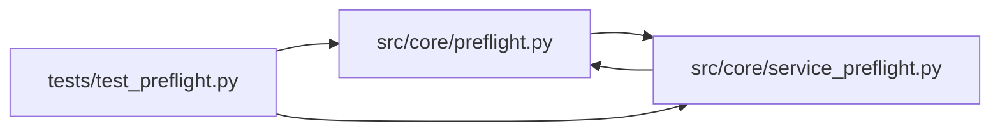

# test_preflight Module

**Path:** `tests/test_preflight.py`

## Description

Structural / contract tests for the ``PreflightCheck`` protocol (ARC-011
P1-019) and the ``HTTPHealthCheck`` / ``TCPConnectCheck`` implementations
(P1-020), plus the P1-021 dispatch migration in ``service_preflight``.

Mirrors ``tests/test_state_store.py`` (P1-009) and ``tests/test_output_parser.py``
(P1-014): these tests pin the public surface of the protocol and guard against
signature drift. The behavioral gate is the existing ``test_service_preflight.py``
suite (7 tests), which exercises ``run_service_preflight`` end-to-end through
the new dispatch path.

## Imports

| Source | Symbols |
|--------|---------|
| `__future__` | `annotations` |
| `httpx` | `httpx` |
| `inspect` | `inspect` |
| `pytest` | `pytest` |
| `src.core.preflight` | `HTTPHealthCheck`, `PreflightCheck`, `TCPConnectCheck`, `preflight_check_from_target` |
| `src.core.service_preflight` | `ServicePreflightTarget`, `spf`, `spf` |
| `typing` | `Protocol` |

## Local dependency map

<!-- Auto-generated local dependency summary. Do not edit by hand. -->

### Internal neighbors

| Direction | Module |
|---|---|
| Outbound | [preflight](../modules/preflight.md) |
| Outbound | [service_preflight](../modules/service_preflight.md) |

### External packages

| Language | Used packages | Undeclared packages |
|---|---:|---:|
| python | 2 | 1 |

## Functions

| Function | Signature | Decorators | Description |
|----------|-----------|------------|-------------|
| `test_preflight_check_protocol_is_typing_time_contract` | `()` | — | ``PreflightCheck`` is a ``Protocol`` and is **not** ``@runtime_checkable``. |
| `test_preflight_check_impl_satisfies_protocol_surface` | `(impl)` | `@pytest.mark.parametrize('impl', [HTTPHealthCheck, TCPConnectCheck], ids=['HTTPHealthCheck', 'TCPConnectCheck'])` | Every attribute/method declared on ``PreflightCheck`` exists on the impl. |
| `test_minimal_preflight_check_satisfies_protocol` | `()` | — | A minimal stub with ``name``/``required``/``check`` satisfies the protocol |
| `test_factory_selects_http_check_for_http_transport` | `()` | — | ``preflight_check_from_target`` returns an ``HTTPHealthCheck`` for an |
| `test_factory_selects_tcp_check_for_tcp_transport` | `()` | — | ``preflight_check_from_target`` returns a ``TCPConnectCheck`` for a |
| `test_http_health_check_delegates_to_service_preflight` | *(async)* `(monkeypatch)` | `@pytest.mark.asyncio` | ``HTTPHealthCheck.check`` delegates to ``service_preflight._check_target`` |
| `test_tcp_connect_check_ignores_client_and_delegates` | *(async)* `(monkeypatch)` | `@pytest.mark.asyncio` | ``TCPConnectCheck.check`` ignores the ``client`` arg (it opens its own |
