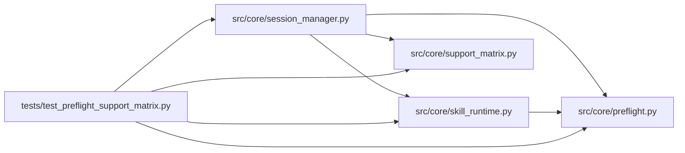

# test_preflight_support_matrix Module

**Path:** `tests/test_preflight_support_matrix.py`

## Description

Tests for preflight enforcement and published executable support.

Contract: every accepted manifest feature maps to an implementing handler and
a conformance case; schema-valid but unimplemented declarations are rejected
before side effects with specific reasons; local-file prerequisites run at
their declared stage (source before bootstrap, generated after — earlier
absence never fails); toolchain availability is diagnostic only and never
broadens execution authority.

## Imports

| Source | Symbols |
|--------|---------|
| `__future__` | `annotations` |
| `asyncio` | `asyncio` |
| `pathlib` | `Path` |
| `pytest` | `pytest` |
| `src.core.preflight` | `LocalFileCheck` |
| `src.core.session_manager` | `SessionManager`, `SessionManager` |
| `src.core.skill_runtime` | `SkillConfigError`, `SkillConfigError` |
| `src.core.support_matrix` | `ACCEPTED_ADVISORY`, `SUPPORT_MATRIX`, `support_descriptor`, `toolchain_diagnostics`, `validate_manifest_support` |
| `types` | `SimpleNamespace` |
| `typing` | `Any`, `Dict`, `Optional` |

## Local dependency map

<!-- Auto-generated local dependency summary. Do not edit by hand. -->

### Internal neighbors

| Direction | Module |
|---|---|
| Outbound | [preflight](../modules/preflight.md) |
| Outbound | [session_manager](../modules/session_manager.md) |
| Outbound | [skill_runtime](../modules/skill_runtime.md) |
| Outbound | [support_matrix](../modules/support_matrix.md) |

### External packages

| Language | Used packages | Undeclared packages |
|---|---:|---:|
| python | 1 | 1 |

## Functions

| Function | Signature | Decorators | Description |
|----------|-----------|------------|-------------|
| `_manifest` | `(*, goal: str = 'optimize', parser_format: str = 'delimited_kv', promotion_kind: str = 'file_path', trial_mode: str = 'declarative', advancement_mode: str = 'declarative', executables: Optional[list] = None, python: Optional[list] = None) -> SimpleNamespace` | — | — |
| `test_every_matrix_row_names_an_existing_conformance_case` | `() -> None` | — | Every advertised feature must have a behavioral conformance case. |
| `test_advisory_declarations_are_published_not_silent` | `() -> None` | — | — |
| `test_unsupported_declarations_carry_specific_reasons` | `() -> None` | — | — |
| `test_unsupported_declarations_fail_before_side_effects` | `(monkeypatch) -> None` | — | — |
| `test_local_file_check_reports_presence_and_stage` | `(tmp_path: Path) -> None` | — | — |
| `test_optional_prerequisites_never_block` | `(tmp_path: Path) -> None` | — | — |
| `_stage_manifest` | `(entries: list) -> SimpleNamespace` | — | — |
| `test_stage_gate_runs_only_its_declared_stage` | *(async)* `(tmp_path: Path, monkeypatch) -> None` | `@pytest.mark.asyncio` | — |
| `test_absent_toolchain_is_diagnosed_without_authority_changes` | `() -> None` | — | — |
