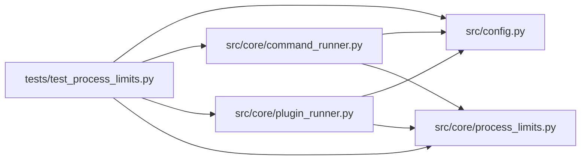

# test_process_limits Module

**Path:** `tests/test_process_limits.py`

## Description

Bounded resource use, output, and cancellation acceptance tests.

Synthetic CPU/memory/output/process workloads assert that a breach stops the
process tree within the documented tested termination bound and produces an
attributed failed record; independent psutil inspection after teardown finds
no orphaned child; unenforceable required caps reject the capability.

## Imports

| Source | Symbols |
|--------|---------|
| `__future__` | `annotations` |
| `asyncio` | `asyncio` |
| `hashlib` | `hashlib` |
| `json` | `json` |
| `pathlib` | `Path` |
| `psutil` | `psutil` |
| `pytest` | `pytest` |
| `src.config` | `get_settings`, `get_settings` |
| `src.core.command_runner` | `CommandProcessRegistry`, `CommandProcessRegistry`, `GovernedCommandRunner`, `GovernedCommandRunner` |
| `src.core.plugin_runner` | `PluginCaps`, `PluginRunner` |
| `src.core.process_limits` | `TERMINATION_BOUND_S`, `ProcessResourceCaps`, `TreeResourceGuard`, `UnenforceableResourceCapabilityError`, `bounded_drain`, `rlimit_prefix`, `terminate_process_tree`, `rlimit_prefix` |
| `subprocess` | `subprocess` |
| `sys` | `sys` |
| `tempfile` | `tempfile` |
| `threading` | `threading` |
| `time` | `time` |

## Local dependency map

<!-- Auto-generated local dependency summary. Do not edit by hand. -->

### Internal neighbors

| Direction | Module |
|---|---|
| Outbound | [config](../modules/config.md) |
| Outbound | [command_runner](../modules/command_runner.md) |
| Outbound | [plugin_runner](../modules/plugin_runner.md) |
| Outbound | [process_limits](../modules/process_limits.md) |

### External packages

| Language | Used packages | Undeclared packages |
|---|---:|---:|
| python | 2 | 2 |

## Functions

| Function | Signature | Decorators | Description |
|----------|-----------|------------|-------------|
| `_guarded_run` | `(code: str, caps: ProcessResourceCaps)` | — | Run one python probe under caps; return (outcome, proc, elapsed). |
| `_assert_no_orphans` | `(pids: list[int]) -> None` | — | Independent process inspection after teardown. |
| `test_cpu_breach_stops_tree_within_bound` | `() -> None` | — | Cumulative CPU breach stops the tree within the documented bound. |
| `test_memory_breach_stops_tree_within_bound` | `() -> None` | — | Process-tree RSS breach stops the tree. |
| `test_output_breach_stops_tree_and_capture_stays_bounded` | `() -> None` | — | Output quota breach terminates; capture itself never grows unbounded. |
| `test_process_count_breach_stops_tree_with_no_orphans` | `() -> None` | — | Process-count breach stops the whole tree; no child survives teardown. |
| `test_file_write_quota_enforced_at_kernel` | `() -> None` | — | Per-file write quota (RLIMIT_FSIZE) stops oversized writes. |
| `test_wall_timeout_stops_tree` | `() -> None` | — | Wall-time breach terminates immediately and is attributed. |
| `test_unenforceable_required_cap_rejects_capability` | `(monkeypatch) -> None` | — | A required cap that cannot be enforced rejects the capability. |
| `test_termination_latency_within_documented_bound` | `() -> None` | — | Record the tested termination bound: breach to tree-gone latency. |
| `_write_probe_plugin` | `(skill_dir: Path, body: str) -> None` | — | — |
| `test_plugin_result_is_attributed_and_failed` | `(tmp_path: Path) -> None` | — | A plugin resource breach is an attributed failed record. |
| `test_registry_cancel_reaps_plugin_tree` | `(tmp_path: Path, monkeypatch: pytest.MonkeyPatch) -> None` | — | Stop/cancel propagates through the plugin (bootstrap) channel. |
| `_cmd_fixture` | `(tmp_path: Path, content: str)` | — | — |
| `test_registry_cancel_reaps_evaluator_tree` | `(tmp_path: Path) -> None` | — | Stop/cancel propagates through the evaluator (command) channel. |
| `test_command_output_quota_attributed` | `(tmp_path: Path, monkeypatch) -> None` | — | The evaluator channel enforces the output quota and attributes it. |
