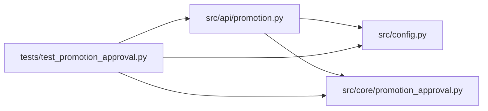

# test_promotion_approval Module

**Path:** `tests/test_promotion_approval.py`

## Description

P0-020 / P0-021 — Mandatory signed production approval bound to a candidate (W18 v2).

Exercises the four acceptance criteria from the ARC-011 backlog
(ARC-011 P0-020/P0-021) plus the v2 candidate binding:

  AC #1  ``POST /promote/confirm`` with ``scope=production`` and missing /
         ``false`` ``approval.approved`` → 4xx.
  AC #2  Approval requires a signature field, verified against a configured
         HMAC-SHA256 verifier (fail-closed when the verifier is unset).
  AC #3  Other scopes are unaffected by the verifier gate.
  AC #4  The ``promotion.confirm`` audit event records the approver identity.

  v2 (BREAKING): the signature covers a canonical stable-JSON message that
  includes the approved candidate — ``iteration`` +
  ``config_snapshot_sha256`` + ``target_identity`` — under method
  ``hmac-sha256-v2`` (``production-approval.v2``). The legacy
  ``"{research_id}:{scope}:{approver}"`` string is intentionally rejected so
  a captured legacy signature cannot approve a substituted candidate. The
  API verifies the *supplied* candidate; core binds it to the actual preview
  before any write.

## Imports

| Source | Symbols |
|--------|---------|
| `__future__` | `annotations` |
| `fastapi` | `FastAPI` |
| `fastapi.testclient` | `TestClient` |
| `hashlib` | `hashlib` |
| `hmac` | `hmac` |
| `json` | `json` |
| `os` | `os` |
| `pydantic` | `SecretStr`, `ValidationError` |
| `pytest` | `pytest` |
| `src.api` | `promotion` |
| `src.api.promotion` | `PromotionApproval`, `PromotionPreviewRequest`, `PromotionScopeRequest`, `_verify_production_approval_signature` |
| `src.config` | `settings` |
| `src.core.promotion_approval` | `APPROVAL_METHOD`, `canonical_approval_message`, `target_identity`, `validate_candidate_binding` |

## Local dependency map

<!-- Auto-generated local dependency summary. Do not edit by hand. -->

### Internal neighbors

| Direction | Module |
|---|---|
| Outbound | [promotion](../modules/promotion.md) |
| Outbound | [config](../modules/config.md) |
| Outbound | [promotion_approval](../modules/promotion_approval.md) |

### External packages

| Language | Used packages | Undeclared packages |
|---|---:|---:|
| python | 3 | 2 |

## Classes

| Class | Line | Bases | Description |
|-------|------|-------|-------------|
| [FakeStore](../entities/test_promotion_approval_FakeStore.md) | 110 | — | Captures audit events so AC #4 can inspect the recorded approver. |
| [FakePromoter](../entities/test_promotion_approval_FakePromoter.md) | 129 | — | Records confirm() invocations so tests can assert it was/wasn't reached. |

## Functions

| Function | Signature | Decorators | Description |
|----------|-----------|------------|-------------|
| `sign_approval` | `(research_id: str, scope: str, approval: dict) -> str` | — | Compute the expected HMAC-SHA256 signature the way the server does. |
| `full_approval` | `(**overrides) -> dict` | — | A structurally valid v2 approval over the fixed candidate. |
| `signed_approval` | `(**overrides) -> dict` | — | A v2 approval whose signature is correct for the (possibly edited) fields. |
| `production_approval_body` | `(**overrides) -> dict` | — | A valid-shaped production approval body (signature defaults to correct). |
| `create_test_app` | `() -> FastAPI` | — | — |
| `configure_module` | `(monkeypatch)` | `@pytest.fixture(autouse=True)` | — |
| `client` | `(configure_module: FakeStore) -> TestClient` | `@pytest.fixture` | — |
| `promoter` | `(configure_module: FakeStore) -> FakePromoter` | `@pytest.fixture` | — |
| `auth_headers` | `() -> dict[str, str]` | — | — |
| `confirm_url` | `(research_id: str = RESEARCH_ID) -> str` | — | — |
| `test_production_scope_without_approval_returns_4xx` | `(client: TestClient) -> None` | — | — |
| `test_production_scope_with_partial_approval_returns_4xx` | `(client: TestClient) -> None` | — | — |
| `test_production_scope_with_false_approved_returns_4xx` | `(client: TestClient) -> None` | — | — |
| `v2_request` | `(approval: dict) -> PromotionScopeRequest` | — | Wrap an approval dict (including its signature) into the confirm model. |
| `test_verifier_rejects_when_secret_unset` | `(monkeypatch) -> None` | — | — |
| `test_verifier_accepts_correct_signature` | `(monkeypatch) -> None` | — | — |
| `test_verifier_rejects_wrong_signature` | `(monkeypatch) -> None` | — | — |
| `test_verifier_rejects_replayed_signature_for_different_research_id` | `(monkeypatch) -> None` | — | A signature valid for one research_id must not validate for another. |
| `test_verifier_rejects_legacy_signature_format` | `(monkeypatch) -> None` | — | A legacy ``{research_id}:{scope}:{approver}`` signature must never verify. |
| `test_structural_validator_rejects_legacy_method` | `() -> None` | — | method=hmac-sha256 is the legacy scheme; v2 is mandatory for production. |
| `test_structural_validator_rejects_missing_candidate_field` | `() -> None` | — | — |
| `test_structural_validator_rejects_non_integer_iteration` | `() -> None` | — | — |
| `test_structural_validator_rejects_malformed_digest` | `() -> None` | — | — |
| `test_http_confirm_fail_closed_when_verifier_unset` | `(client: TestClient, promoter: FakePromoter, configure_module: FakeStore, monkeypatch) -> None` | — | — |
| `test_http_confirm_rejects_wrong_signature` | `(client: TestClient, promoter: FakePromoter, monkeypatch) -> None` | — | — |
| `test_http_confirm_accepts_valid_signature` | `(client: TestClient, promoter: FakePromoter, monkeypatch) -> None` | — | — |
| `test_development_scope_unaffected_without_verifier` | `(client: TestClient, promoter: FakePromoter, monkeypatch) -> None` | — | — |
| `test_canary_scope_unaffected_without_verifier` | `(client: TestClient, promoter: FakePromoter, monkeypatch) -> None` | — | — |
| `_confirm_audit_event` | `(store: FakeStore) -> dict` | — | — |
| `test_audit_records_approver_on_success` | `(client: TestClient, configure_module: FakeStore, monkeypatch) -> None` | — | — |
| `test_audit_records_approver_on_signature_failure` | `(client: TestClient, configure_module: FakeStore, monkeypatch) -> None` | — | — |
| `test_audit_records_scope_only_for_non_production` | `(client: TestClient, configure_module: FakeStore, monkeypatch) -> None` | — | — |
| `test_production_alias_requires_signed_approval` | `(client, promoter, scope)` | `@pytest.mark.parametrize('scope', ['prod', 'live', ' production ', 'PRODUCTION'])` | — |
| `test_production_alias_cannot_bypass_verifier` | `(client, promoter, monkeypatch, scope, configured)` | `@pytest.mark.parametrize('scope', ['prod', 'live', ' production ', 'PRODUCTION'])`, `@pytest.mark.parametrize('configured', [False, True])` | — |
| `test_production_alias_uses_canonical_signature` | `(client, promoter, monkeypatch, scope)` | `@pytest.mark.parametrize('scope', ['prod', 'live', ' production ', 'PRODUCTION'])` | — |
