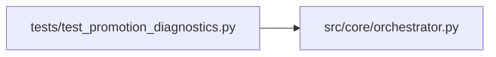

# test_promotion_diagnostics Module

**Path:** `tests/test_promotion_diagnostics.py`

## Description

Gap 3 — auto-promotion skip diagnostics include collection errors.

Live evidence (``res_baf6605ce94f``, ``res_dd666f273f99``) shows that
``Auto-promotion skipped: reason=promotion_preview_blocked`` was logged
with high-level blocker codes only (``inference_adapter_load_failure``,
``inference_reload_failed``, etc.). The underlying error reason from
``PromotionEvidenceCollector`` (e.g. ``adapter_preflight_failed: ConnectTimeout``,
``reload_dry_run_status_502``) was already persisted in the iteration's
``promotion_evidence_collection_errors`` map but NOT surfaced to operators.

Gap 3 wires that map into the auto-promotion-skipped audit event, log line,
and broadcast payload so operators can distinguish infrastructure failures
(retry / fix downstream) from genuine validation failures.

## Imports

| Source | Symbols |
|--------|---------|
| `__future__` | `annotations` |
| `anthropic` | `anthropic` |
| `json` | `json` |
| `pytest` | `pytest` |
| `src.core` | `orchestrator` |
| `src.core.orchestrator` | `AgentOrchestrator`, `ResearchConfig` |
| `sys` | `sys` |
| `types` | `types` |
| `typing` | `Any`, `Dict`, `List`, `Optional` |

## Local dependency map

<!-- Auto-generated local dependency summary. Do not edit by hand. -->

### Internal neighbors

| Direction | Module |
|---|---|
| Outbound | [orchestrator](../modules/orchestrator.md) |

### External packages

| Language | Used packages | Undeclared packages |
|---|---:|---:|
| python | 2 | 2 |

## Classes

| Class | Line | Bases | Description |
|-------|------|-------|-------------|
| [FakeAgentLog](../entities/test_promotion_diagnostics_FakeAgentLog.md) | 40 | — | — |
| [FakeBroadcaster](../entities/test_promotion_diagnostics_FakeBroadcaster.md) | 48 | — | — |
| [FakeStore](../entities/test_promotion_diagnostics_FakeStore.md) | 56 | — | — |

## Functions

| Function | Signature | Decorators | Description |
|----------|-----------|------------|-------------|
| `_config` | `() -> ResearchConfig` | — | — |
| `_orchestrator` | `(store: FakeStore) -> AgentOrchestrator` | — | — |
| `_patch_broadcaster` | `(monkeypatch: pytest.MonkeyPatch) -> FakeBroadcaster` | `@pytest.fixture(autouse=True)` | — |
| `test_skip_without_errors_omits_collection_errors_key` | *(async)* `(_patch_broadcaster: FakeBroadcaster) -> None` | `@pytest.mark.asyncio` | Backwards compatible: when no collection_errors are supplied, none |
| `test_skip_with_errors_surfaces_them_to_all_sinks` | *(async)* `(_patch_broadcaster: FakeBroadcaster) -> None` | `@pytest.mark.asyncio` | Gap 3 path: when collection_errors are provided, they appear in |
| `test_skip_with_empty_errors_dict_treated_as_no_errors` | *(async)* `(_patch_broadcaster: FakeBroadcaster) -> None` | `@pytest.mark.asyncio` | Defensive: an empty dict (no errors collected, but the kwarg was |
