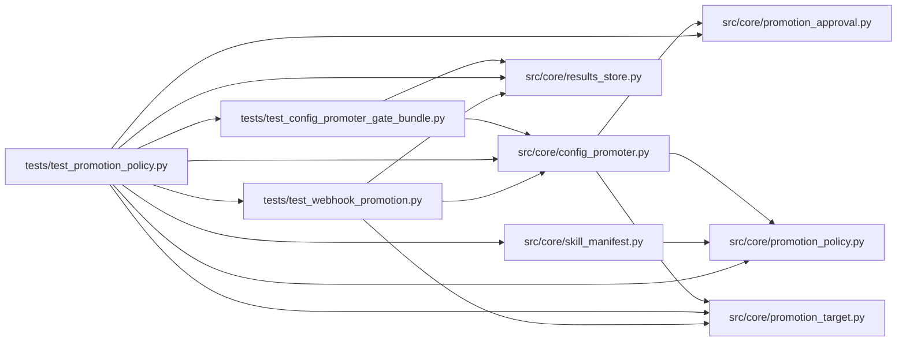

# test_promotion_policy Module

**Path:** `tests/test_promotion_policy.py`

## Description

Promotion policy acceptance: compiled scope graph, canonical identity, effects.

The tests cover the promotion-policy acceptance: a declared non-ML
development-to-production policy needs no fabricated ML evidence, invalid or
cyclic scope declarations are rejected at load, stale approvals cannot
promote a changed winner, history and rollback lookups separate skills and
targets by canonical identity, ambiguous legacy rollback requires explicit
reconciliation, and file/webhook effects follow the intent-acknowledgement
journal with idempotent retries and reconciliation.

## Imports

| Source | Symbols |
|--------|---------|
| `__future__` | `annotations` |
| `hashlib` | `hashlib` |
| `httpx` | `httpx` |
| `json` | `json` |
| `pathlib` | `Path` |
| `pytest` | `pytest` |
| `src.core` | `config_promoter`, `config_promoter` |
| `src.core.config_promoter` | `ConfigPromoter` |
| `src.core.promotion_approval` | `validate_candidate_binding` |
| `src.core.promotion_policy` | `SCOPE_EVIDENCE_VALIDATORS`, `ScopePolicyError`, `compile_scope_graph` |
| `src.core.promotion_target` | `WebhookDeliveryError` |
| `src.core.results_store` | `ResultsStore` |
| `src.core.skill_manifest` | `PromotionTarget` |
| `tests.test_config_promoter_gate_bundle` | `_passing_metrics`, `_write_gate_bundle_with_m7_controls` |
| `tests.test_webhook_promotion` | `_patch_mock_transport`, `_primary_path`, `_webhook_target` |

## Local dependency map

<!-- Auto-generated local dependency summary. Do not edit by hand. -->

### Internal neighbors

| Direction | Module |
|---|---|
| Outbound | [config_promoter](../modules/config_promoter.md) |
| Outbound | [promotion_approval](../modules/promotion_approval.md) |
| Outbound | [promotion_policy](../modules/promotion_policy.md) |
| Outbound | [promotion_target](../modules/promotion_target.md) |
| Outbound | [results_store](../modules/results_store.md) |
| Outbound | [skill_manifest](../modules/skill_manifest.md) |
| Outbound | [test_config_promoter_gate_bundle](../modules/test_config_promoter_gate_bundle.md) |
| Outbound | [test_webhook_promotion](../modules/test_webhook_promotion.md) |

### External packages

| Language | Used packages | Undeclared packages |
|---|---:|---:|
| python | 2 | 1 |

## Classes

| Class | Line | Bases | Description |
|-------|------|-------|-------------|
| [_Decl](../entities/Decl.md) | 33 | — | — |

## Functions

| Function | Signature | Decorators | Description |
|----------|-----------|------------|-------------|
| `_non_ml_graph` | `()` | — | Synthetic non-ML development-to-production policy (no ML evidence). |
| `test_compile_scope_graph_compiles_synthetic_non_ml_graph` | `()` | — | — |
| `test_compile_scope_graph_rejects_undeclared_prior` | `()` | — | — |
| `test_compile_scope_graph_rejects_cyclic_and_self_referential_scopes` | `()` | — | — |
| `test_compile_scope_graph_rejects_unknown_evidence_names` | `()` | — | — |
| `test_manifest_rejects_invalid_scope_graph_at_load` | `()` | — | — |
| `_scoped_production_metadata` | *(async)* `(evidence_payload, monkeypatch, tmp_path)` | — | Scoped production metadata through the real promoter path. |
| `test_declared_non_ml_scope_requires_no_ml_evidence` | *(async)* `(monkeypatch, tmp_path)` | `@pytest.mark.asyncio` | A declared non-ML policy needs no fabricated ML evidence. |
| `test_prior_promotion_lookup_separates_by_canonical_identity` | *(async)* `(tmp_path)` | `@pytest.mark.asyncio` | Two skills on two targets never share prior-promotion history. |
| `test_stale_approval_cannot_promote_changed_winner` | `()` | — | An approval bound to one candidate never promotes a changed winner. |
| `_ensure_session` | *(async)* `(store)` | — | Promotion rows require their research session (FK). |
| `_seed_one_promotion` | *(async)* `(store, *, metadata, tmp_path, name = 'config.yaml')` | — | — |
| `test_ambiguous_legacy_rollback_requires_explicit_reconciliation` | *(async)* `(tmp_path, monkeypatch)` | `@pytest.mark.asyncio` | — |
| `test_rollback_refuses_foreign_target_identity` | *(async)* `(tmp_path)` | `@pytest.mark.asyncio` | — |
| `_confirm_ready_store` | *(async)* `(tmp_path, monkeypatch)` | — | — |
| `test_effect_intent_is_recorded_before_the_external_write` | *(async)* `(tmp_path, monkeypatch)` | `@pytest.mark.asyncio` | A crash between effect and acknowledgement stays reconcilable. |
| `test_reconcile_promotion_effect_marks_applied_or_failed` | *(async)* `(tmp_path)` | `@pytest.mark.asyncio` | — |
| `test_fault_injected_webhook_receiver_fails_delivery_idempotently` | *(async)* `(monkeypatch, tmp_path)` | `@pytest.mark.asyncio` | The agent-owned receiver faults; retries carry one idempotency key. |
