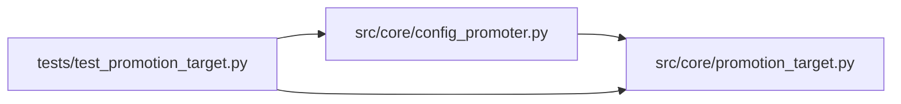

# test_promotion_target Module

**Path:** `tests/test_promotion_target.py`

## Description

Structural / contract tests for the ``PromotionTarget`` protocol (ARC-011
P1-015) and the ``FilePathPromotionTarget`` implementation (P1-016), plus the
P1-017 wiring of ``ConfigPromoter`` to delegate its file-write surface to the
target.

Mirrors ``tests/test_state_store.py`` (P1-009) and ``tests/test_output_parser.py``
(P1-014): these tests pin the public surface of the protocol and guard against
signature drift. The behavioral gate is the existing ``ConfigPromoter`` suite
(``test_config_promoter_gate_bundle.py`` etc.) and the X-002 parity fixture
``promotion_preview/development_scope_basic.json`` — which bakes
``target_path: "<host_configs>/direction/DOGE_USDT_15m.yaml"``, so the
path-derivation contract is locked.

## Imports

| Source | Symbols |
|--------|---------|
| `__future__` | `annotations` |
| `asyncio` | `asyncio` |
| `inspect` | `inspect` |
| `pytest` | `pytest` |
| `src.core.config_promoter` | `ConfigPromoter` |
| `src.core.promotion_target` | `FilePathPromotionTarget`, `PromotionTarget` |
| `typing` | `Protocol` |

## Local dependency map

<!-- Auto-generated local dependency summary. Do not edit by hand. -->

### Internal neighbors

| Direction | Module |
|---|---|
| Outbound | [config_promoter](../modules/config_promoter.md) |
| Outbound | [promotion_target](../modules/promotion_target.md) |

### External packages

| Language | Used packages | Undeclared packages |
|---|---:|---:|
| python | 1 | 1 |

## Classes

| Class | Line | Bases | Description |
|-------|------|-------|-------------|
| [_FakeStore](../entities/test_promotion_target_FakeStore.md) | 143 | — | — |
| [_RecordingTarget](../entities/RecordingTarget.md) | 147 | — | Records every dispatch; returns fixed values (ARC-011 review C2-5). |

## Functions

| Function | Signature | Decorators | Description |
|----------|-----------|------------|-------------|
| `test_promotion_target_protocol_is_typing_time_contract` | `()` | — | ``PromotionTarget`` is a ``Protocol`` and is **not** ``@runtime_checkable``. |
| `test_promotion_target_protocol_surface_matches_impl` | `()` | — | Every method declared on ``PromotionTarget`` exists on |
| `test_minimal_promotion_target_satisfies_protocol` | `()` | — | A minimal stub with the six methods satisfies the protocol at the type |
| `test_target_path_derivation_matches_golden` | `(model_type, instrument, timeframe, expected_suffix)` | `@pytest.mark.parametrize('model_type,instrument,timeframe,expected_suffix', [('direction', 'DOGE_USDT', '15m', 'direction/DOGE_USDT_15m.yaml'), ('volatility', 'BTC_USDT', '1h', 'volatility/BTC_USDT_1h.yaml'), ('rl', 'ETH_USDT', '5m', 'rl/ETH_USDT_5m.yaml')])` | ``FilePathPromotionTarget.target_path`` reproduces the exact path string |
| `test_config_promoter_target_path_delegates_to_impl` | `()` | — | ``ConfigPromoter(store)._get_target_path`` (default target) produces |
| `test_config_promoter_dispatches_through_injected_target` | `()` | — | H6/C2-5: every historical helper routes through the injected |
| `test_config_promoter_accepts_injected_target` | `()` | — | P1-017: ``ConfigPromoter`` accepts an optional ``target`` and defaults to |
| `test_metadata_sidecar_path_shape` | `()` | — | ``metadata_sidecar_path`` shape: ``<name>.<scope>-promotion.iter-<N>.json``. |
| `test_rollback_paths_shape` | `()` | — | Rollback snapshot + metadata sidecar shapes match the old statics. |
