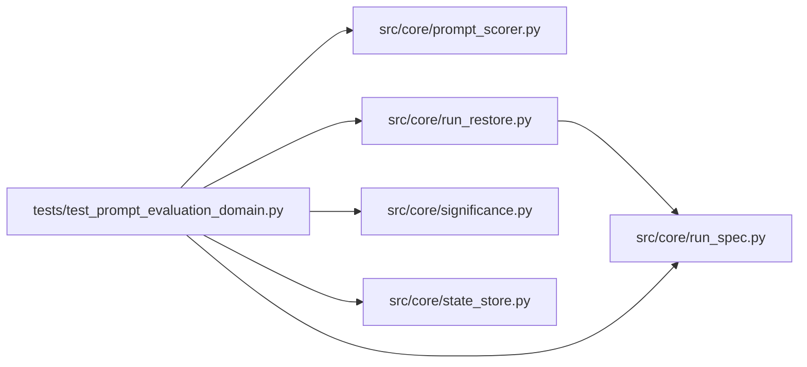

# test_prompt_evaluation_domain Module

**Path:** `tests/test_prompt_evaluation_domain.py`

## Description

The prompt-evaluation domain: pinned data, a controlled real scorer.

Verification covers the live controlled-scorer run through a local
endpoint, deterministic endpoint fixtures, failure with no simulator
fallback, data tampering, and continuation with nondefault settings.
Offline endpoint fixtures are separate evidence — never a live
substitute.

## Imports

| Source | Symbols |
|--------|---------|
| `__future__` | `annotations` |
| `asyncio` | `asyncio` |
| `fastapi` | `FastAPI` |
| `httpx` | `httpx` |
| `json` | `json` |
| `pathlib` | `Path` |
| `pytest` | `pytest` |
| `src.core.prompt_scorer` | `DATASET_ROLE_HOLDOUT`, `DATASET_ROLE_TRAIN`, `SCORE_REQUEST_SCHEMA`, `SCORE_RESULT_SCHEMA`, `ControlledLocalScorer`, `DatasetTampered`, `OfflineDemoScorer`, `PinnedDataset`, `ScorerClient`, `ScorerIdentity`, `ScorerUnavailable`, `bind_promotion_to_candidate`, `build_score_request`, `pin_dataset`, `record_scorer_usage`, `scorer_pin`, `verify_dataset` |
| `src.core.run_restore` | `assess_recovery` |
| `src.core.run_spec` | `build_run_spec`, `verify_run_spec` |
| `src.core.significance` | `qualification_status` |
| `src.core.state_store` | `SQLiteStateStore` |

## Local dependency map

<!-- Auto-generated local dependency summary. Do not edit by hand. -->

### Internal neighbors

| Direction | Module |
|---|---|
| Outbound | [prompt_scorer](../modules/prompt_scorer.md) |
| Outbound | [run_restore](../modules/run_restore.md) |
| Outbound | [run_spec](../modules/run_spec.md) |
| Outbound | [significance](../modules/significance.md) |
| Outbound | [state_store](../modules/state_store.md) |

### External packages

| Language | Used packages | Undeclared packages |
|---|---:|---:|
| python | 3 | 2 |

## Functions

| Function | Signature | Decorators | Description |
|----------|-----------|------------|-------------|
| `datasets` | `()` | `@pytest.fixture` | — |
| `test_pinned_datasets_and_scorer_identity` | `(datasets)` | — | — |
| `test_controlled_scorer_evaluates_real_outputs` | `(datasets)` | — | — |
| `test_live_local_endpoint_run` | `(datasets)` | — | The controlled scorer behind a real local HTTP endpoint. |
| `test_failure_never_invokes_a_simulator` | `(datasets)` | — | — |
| `test_data_tampering_is_refused` | `(datasets)` | — | — |
| `test_continuation_preserves_the_pinned_configuration` | `(datasets)` | — | — |
| `test_optimization_and_qualification_evidence_are_distinguishable` | `(datasets)` | — | — |
| `test_candidate_bound_promotion_fixture` | `(datasets)` | — | — |
| `test_scorer_usage_is_accounted` | `(tmp_path, datasets)` | — | — |
| `test_offline_demo_mode_is_separate_evidence` | `(datasets)` | — | — |
