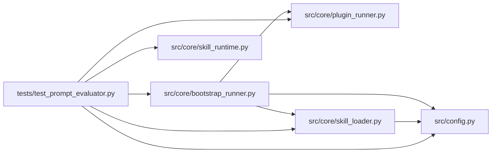

# test_prompt_evaluator Module

**Path:** `tests/test_prompt_evaluator.py`

## Description

Prompt evaluator/bootstrap fail-closed regressions; no external services.

## Imports

| Source | Symbols |
|--------|---------|
| `__future__` | `annotations` |
| `importlib.util` | `importlib.util` |
| `io` | `io` |
| `json` | `json` |
| `pathlib` | `Path` |
| `pytest` | `pytest` |
| `shlex` | `shlex` |
| `src.config` | `settings`, `settings` |
| `src.core.bootstrap_runner` | `BootstrapRunner` |
| `src.core.plugin_runner` | `PluginResult` |
| `src.core.skill_loader` | `load_skill_manifest`, `load_layout`, `load_skill_manifest` |
| `src.core.skill_runtime` | `ManifestSkillRuntime` |
| `sys` | `sys` |
| `types` | `types` |
| `urllib.request` | `urllib.request`, `urllib.request`, `urllib.request` |

## Local dependency map

<!-- Auto-generated local dependency summary. Do not edit by hand. -->

### Internal neighbors

| Direction | Module |
|---|---|
| Outbound | [config](../modules/config.md) |
| Outbound | [bootstrap_runner](../modules/bootstrap_runner.md) |
| Outbound | [plugin_runner](../modules/plugin_runner.md) |
| Outbound | [skill_loader](../modules/skill_loader.md) |
| Outbound | [skill_runtime](../modules/skill_runtime.md) |

### External packages

| Language | Used packages | Undeclared packages |
|---|---:|---:|
| python | 1 | 1 |

## Functions

| Function | Signature | Decorators | Description |
|----------|-----------|------------|-------------|
| `evaluator` | `(monkeypatch)` | `@pytest.fixture` | — |
| `bootstrap` | `(monkeypatch)` | `@pytest.fixture` | — |
| `invoke_bootstrap` | `(module, monkeypatch, workspace, **extra)` | — | — |
| `test_live_has_no_ambient_fallback` | `(evaluator, monkeypatch)` | — | — |
| `test_bad_remote_never_falls_back` | `(evaluator, monkeypatch, body, demo)` | `@pytest.mark.parametrize('demo', [False, True])`, `@pytest.mark.parametrize('body', [b'{}', b'[]', b'not json', b'{"score":NaN}', b'{"score":true}', b'{"score":1.1}', b'{"score":0.9,"precision":-1}', b'{"status":"eval_error","score":0.9}'])` | — |
| `test_remote_transport_failure` | `(evaluator, monkeypatch, failure)` | `@pytest.mark.parametrize('failure', [TimeoutError(), OSError('offline')])` | — |
| `test_valid_remote_receives_selected_dataset` | `(evaluator, monkeypatch)` | — | — |
| `test_cli_error_marker_is_not_promotable` | `(evaluator, monkeypatch, tmp_path, capsys)` | — | — |
| `test_dataset_invalid_before_any_writes` | `(bootstrap, monkeypatch, tmp_path, raw)` | `@pytest.mark.parametrize('raw', ['', '{}', '[]', 'null', 'not JSON', '{"input":1,"expected":"a"}', '{"input":"q","expected":"a","code":"print(1)"}'])` | — |
| `test_bootstrap_uses_data_only_and_preserves_edits` | `(bootstrap, monkeypatch, tmp_path)` | — | — |
| `test_bootstrap_requires_server_demo` | `(bootstrap, monkeypatch, tmp_path)` | — | — |
| `test_bootstrap_rejects_symlink_dataset` | `(bootstrap, monkeypatch, tmp_path)` | — | — |
| `test_command_wiring_is_explicit` | `(monkeypatch, demo, environment, expected)` | `@pytest.mark.parametrize('demo,environment,expected', [(False, 'development', 'false'), (True, 'development', 'true'), (True, 'production', 'false')])` | — |
| `test_runner_threads_dataset_and_server_demo` | *(async)* `(monkeypatch, tmp_path, dry)` | `@pytest.mark.asyncio`, `@pytest.mark.parametrize('dry', [False, True])` | — |
