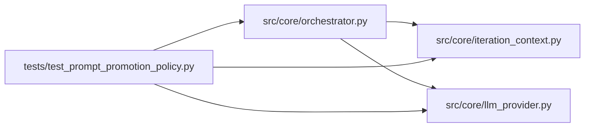

# test_prompt_promotion_policy Module

**Path:** `tests/test_prompt_promotion_policy.py`

## Description

_Auto-generated from `tests/test_prompt_promotion_policy.py`._

## Imports

| Source | Symbols |
|--------|---------|
| `__future__` | `annotations` |
| `anthropic` | `anthropic` |
| `pathlib` | `Path` |
| `pytest` | `pytest` |
| `src.core` | `orchestrator` |
| `src.core.iteration_context` | `ITERATION_CONTEXT_DIGEST_MARKER` |
| `src.core.llm_provider` | `Message`, `TextBlock`, `ToolResultBlock` |
| `src.core.orchestrator` | `PROMOTION_HANDOFF_INSTRUCTION`, `AgentOrchestrator`, `ResearchConfig` |
| `sys` | `sys` |
| `types` | `types` |

## Local dependency map

<!-- Auto-generated local dependency summary. Do not edit by hand. -->

### Internal neighbors

| Direction | Module |
|---|---|
| Outbound | [iteration_context](../modules/iteration_context.md) |
| Outbound | [llm_provider](../modules/llm_provider.md) |
| Outbound | [orchestrator](../modules/orchestrator.md) |

### External packages

| Language | Used packages | Undeclared packages |
|---|---:|---:|
| python | 2 | 2 |

## Classes

| Class | Line | Bases | Description |
|-------|------|-------|-------------|
| [_FakeAsyncAnthropic](../entities/test_prompt_promotion_policy_FakeAsyncAnthropic.md) | 12 | — | — |
| [_FakeAPIStatusError](../entities/test_prompt_promotion_policy_FakeAPIStatusError.md) | 16 | `Exception` | — |

## Functions

| Function | Signature | Decorators | Description |
|----------|-----------|------------|-------------|
| `_config` | `(model_type: str, **overrides) -> ResearchConfig` | — | — |
| `test_prompt_sources_do_not_instruct_direct_promote_py` | `()` | — | — |
| `test_duplicate_training_guard_rejects_same_identity` | *(async)* `()` | `@pytest.mark.asyncio` | — |
| `test_iteration_context_digest_appended_after_recorded_attempt` | *(async)* `(monkeypatch)` | `@pytest.mark.asyncio` | — |
| `test_iteration_context_digest_not_appended_without_recorded_attempt` | *(async)* `(monkeypatch)` | `@pytest.mark.asyncio` | — |
| `test_iteration_context_digest_disabled` | *(async)* `(monkeypatch)` | `@pytest.mark.asyncio` | — |
| `test_compaction_retains_latest_iteration_context_digest` | `()` | — | — |
