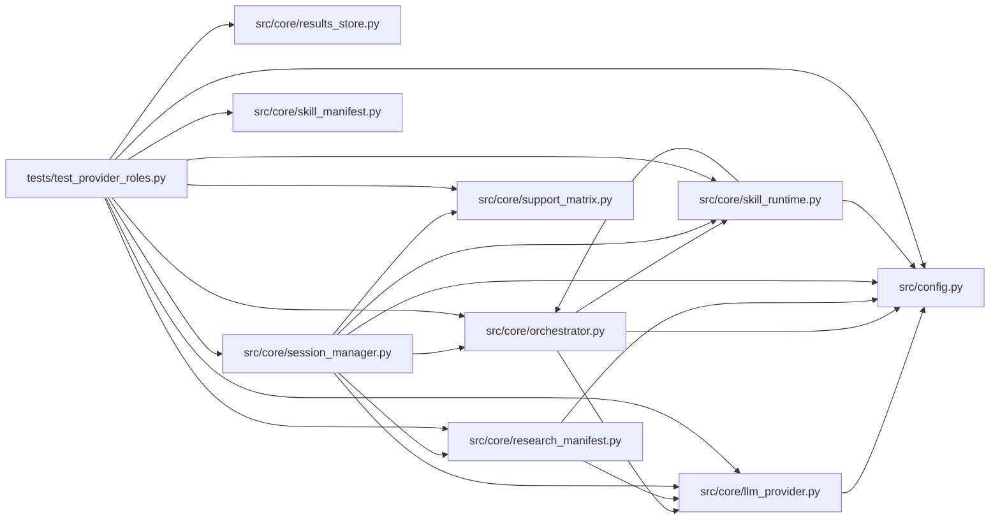

# test_provider_roles Module

**Path:** `tests/test_provider_roles.py`

## Description

Provider/model roles and capabilities resolve consistently on every path.

The manifest's primary/insight model roles and output caps apply to all
provider paths including the default one; capabilities are validated before
session side effects; provider-specific request options stay behind the
adapter and unsupported combinations are rejected with actionable
diagnostics instead of silently substituting another model.

## Imports

| Source | Symbols |
|--------|---------|
| `__future__` | `annotations` |
| `pytest` | `pytest` |
| `src.config` | `settings` |
| `src.core.llm_provider` | `AnthropicProvider`, `ModelRoles`, `OpenAIProvider`, `ProviderCapabilities`, `ProviderCapabilityMismatch`, `RequiredCapabilities`, `UnsupportedModelSetting`, `clamp_output_tokens`, `resolve_model_roles`, `resolve_effective_provider` |
| `src.core.orchestrator` | `ResearchConfig` |
| `src.core.research_manifest` | `_model_identity` |
| `src.core.results_store` | `ResultsStore` |
| `src.core.session_manager` | `SessionManager` |
| `src.core.skill_manifest` | `LLMConfig` |
| `src.core.skill_runtime` | `skill_runtime_mod` |
| `src.core.support_matrix` | `support_matrix_mod` |
| `types` | `types` |

## Local dependency map

<!-- Auto-generated local dependency summary. Do not edit by hand. -->

### Internal neighbors

| Direction | Module |
|---|---|
| Outbound | [config](../modules/config.md) |
| Outbound | [llm_provider](../modules/llm_provider.md) |
| Outbound | [orchestrator](../modules/orchestrator.md) |
| Outbound | [research_manifest](../modules/research_manifest.md) |
| Outbound | [results_store](../modules/results_store.md) |
| Outbound | [session_manager](../modules/session_manager.md) |
| Outbound | [skill_manifest](../modules/skill_manifest.md) |
| Outbound | [skill_runtime](../modules/skill_runtime.md) |
| Outbound | [support_matrix](../modules/support_matrix.md) |

### External packages

| Language | Used packages | Undeclared packages |
|---|---:|---:|
| python | 1 | 1 |

## Classes

| Class | Line | Bases | Description |
|-------|------|-------|-------------|
| [_Settings](../entities/test_provider_roles_Settings.md) | 29 | — | — |
| [_FakeMessages](../entities/FakeMessages.md) | 89 | — | — |
| [_FakeAnthropicClient](../entities/FakeAnthropicClient.md) | 102 | — | — |
| [_FakeCompletions](../entities/FakeCompletions.md) | 141 | — | — |
| [_FakeOpenAIClient](../entities/FakeOpenAIClient.md) | 155 | — | — |

## Functions

| Function | Signature | Decorators | Description |
|----------|-----------|------------|-------------|
| `test_manifest_roles_apply_on_the_default_provider_path` | `()` | — | — |
| `test_nonanthropic_without_primary_model_is_rejected_with_diagnostics` | `()` | — | — |
| `test_clamp_output_tokens_honors_provider_and_settings_caps` | `()` | — | — |
| `_anthropic_provider` | `()` | — | — |
| `test_anthropic_request_honors_roles_and_caps` | *(async)* `()` | `@pytest.mark.asyncio` | — |
| `_openai_provider` | `()` | — | — |
| `test_openai_request_honors_roles_and_caps` | *(async)* `()` | `@pytest.mark.asyncio` | — |
| `test_insight_calls_honor_the_manifest_role_and_cap` | *(async)* `()` | `@pytest.mark.asyncio` | — |
| `test_output_cap_demand_rejects_unsatisfiable_settings` | `()` | — | — |
| `test_unsupported_combination_fails_before_session_creation` | *(async)* `(tmp_path, monkeypatch)` | `@pytest.mark.asyncio` | — |
| `test_effective_config_records_requested_versus_effective_identity` | `()` | — | — |
| `test_global_provider_and_model_override_routes_skill_to_local_llm` | `()` | — | — |
