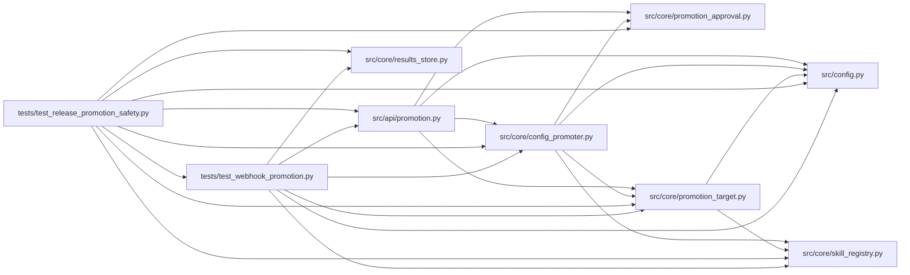

# test_release_promotion_safety Module

**Path:** `tests/test_release_promotion_safety.py`

## Description

Release regressions for durable remote rollback and candidate binding.

## Imports

| Source | Symbols |
|--------|---------|
| `__future__` | `annotations` |
| `hashlib` | `hashlib` |
| `httpx` | `httpx` |
| `json` | `json` |
| `pathlib` | `Path` |
| `pytest` | `pytest` |
| `src.api` | `promotion` |
| `src.config` | `settings` |
| `src.core.config_promoter` | `ConfigPromoter` |
| `src.core.promotion_approval` | `target_identity` |
| `src.core.promotion_target` | `WebhookDeliveryError`, `WebhookPromotionTarget` |
| `src.core.results_store` | `ResultsStore` |
| `src.core.skill_registry` | `SkillRegistry` |
| `tests.test_webhook_promotion` | `_patch_mock_transport`, `_seed_completed_skill_session` |
| `unittest.mock` | `AsyncMock` |

## Local dependency map

<!-- Auto-generated local dependency summary. Do not edit by hand. -->

### Internal neighbors

| Direction | Module |
|---|---|
| Outbound | [promotion](../modules/promotion.md) |
| Outbound | [config](../modules/config.md) |
| Outbound | [config_promoter](../modules/config_promoter.md) |
| Outbound | [promotion_approval](../modules/promotion_approval.md) |
| Outbound | [promotion_target](../modules/promotion_target.md) |
| Outbound | [results_store](../modules/results_store.md) |
| Outbound | [skill_registry](../modules/skill_registry.md) |
| Outbound | [test_webhook_promotion](../modules/test_webhook_promotion.md) |

### External packages

| Language | Used packages | Undeclared packages |
|---|---:|---:|
| python | 2 | 1 |

## Functions

| Function | Signature | Decorators | Description |
|----------|-----------|------------|-------------|
| `test_confirmation_rejects_candidate_changed_since_approval` | *(async)* `(field, value)` | `@pytest.mark.asyncio`, `@pytest.mark.parametrize('field,value', [('iteration', 8), ('config_snapshot_sha256', 'b' * 64), ('target_identity', 'c' * 64)])` | — |
| `test_confirmation_records_exact_approved_preview` | *(async)* `(tmp_path)` | `@pytest.mark.asyncio` | — |
| `test_webhook_rollback_after_restart_uses_recorded_destination` | *(async)* `(monkeypatch, tmp_path, fail_restore)` | `@pytest.mark.asyncio`, `@pytest.mark.parametrize('fail_restore', [False, True])` | — |
| `test_failed_delivery_preserves_local_provenance` | *(async)* `(monkeypatch, tmp_path)` | `@pytest.mark.asyncio` | — |
| `test_file_path_skill_rollback_restores_promoted_template` | *(async)* `(monkeypatch, tmp_path)` | `@pytest.mark.asyncio` | ARC-012 P7-014: a ``file_path`` skill's rollback restores the previous |
