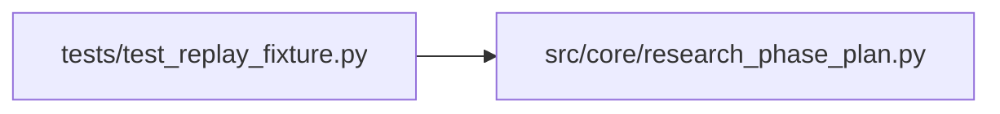

# test_replay_fixture Module

**Path:** `tests/test_replay_fixture.py`

## Description

AR-9: Smoke tests for the replay_iterations fixture infrastructure.

Verifies that:
- The JSON fixture file is well-formed and parseable.
- The replay_iterations factory creates a seeded ResultsStore.
- The seeded iterations have the correct shapes for each defect scenario.
- The fixture correctly exposes the four key broken-session iterations
  (90, 95, 101, 102) that are the focus of the AR-9/AR-10 work.
- Phase-completion iterations (85-90) cause build_phase_state to correctly
  place the current_phase at multi_seed_robustness (not an earlier phase).

## Imports

| Source | Symbols |
|--------|---------|
| `__future__` | `annotations` |
| `json` | `json` |
| `pathlib` | `Path` |
| `pytest` | `pytest` |
| `src.core.research_phase_plan` | `build_phase_state` |
| `typing` | `Any`, `Dict` |

## Local dependency map

<!-- Auto-generated local dependency summary. Do not edit by hand. -->

### Internal neighbors

| Direction | Module |
|---|---|
| Outbound | [research_phase_plan](../modules/research_phase_plan.md) |

### External packages

| Language | Used packages | Undeclared packages |
|---|---:|---:|
| python | 1 | 1 |

## Functions

| Function | Signature | Decorators | Description |
|----------|-----------|------------|-------------|
| `_iter_by_number` | `(iterations: list, n: int) -> Dict[str, Any]` | — | Return the iteration row whose ``iteration`` column == n. |
| `_metrics_of` | `(row: Dict[str, Any]) -> Dict[str, Any]` | — | — |
| `test_fixture_file_exists` | `() -> None` | — | The JSON fixture file must exist under tests/fixtures/. |
| `test_fixture_json_is_valid` | `() -> None` | — | The JSON file must parse without error. |
| `test_fixture_contains_required_session_fields` | `() -> None` | — | Session config must have all fields required by create_session. |
| `test_fixture_contains_key_broken_iterations` | `() -> None` | — | The four defect-focused iterations (90, 95, 101, 102) must be present. |
| `test_fixture_iter102_exposes_config_snapshot_as_dict` | `() -> None` | — | Iter 102 must have config_snapshot_as_dict for AR-10 D1 crash tests. |
| `test_replay_iterations_seeds_session` | *(async)* `(replay_iterations) -> None` | `@pytest.mark.asyncio` | Factory creates a session with the correct ID and instrument. |
| `test_replay_iterations_seeds_all_iterations` | *(async)* `(replay_iterations) -> None` | `@pytest.mark.asyncio` | All iterations in the JSON file are written to the DB. |
| `test_replay_iterations_exposes_raw_fixture` | *(async)* `(replay_iterations) -> None` | `@pytest.mark.asyncio` | ReplayContext.raw must contain the full parsed JSON fixture. |
| `test_replay_iterations_stores_metrics_json` | *(async)* `(replay_iterations) -> None` | `@pytest.mark.asyncio` | Iteration metrics are stored as JSON-serialized strings in the DB. |
| `test_replay_iterations_iter95_has_synthetic_seed_trials` | *(async)* `(replay_iterations) -> None` | `@pytest.mark.asyncio` | Iter 95 (D3 defect): seed_trials all share the same mlflow_run_id. |
| `test_replay_iterations_iter101_has_no_config_snapshot` | *(async)* `(replay_iterations) -> None` | `@pytest.mark.asyncio` | Iter 101 (D4 defect): config_snapshot is null in the DB. |
| `test_replay_iterations_iter90_has_real_training_data` | *(async)* `(replay_iterations) -> None` | `@pytest.mark.asyncio` | Iter 90: the real training iteration — config_snapshot + mlflow_run_id |
| `test_replay_fixture_phase_plan_reaches_multi_seed_robustness` | *(async)* `(replay_iterations) -> None` | `@pytest.mark.asyncio` | Phase plan computed from fixture iterations must keep the agent |
| `test_replay_fixture_best_metric_is_iter90` | *(async)* `(replay_iterations) -> None` | `@pytest.mark.asyncio` | Session best_metric must be set to iter-90's metric (0.6394) by the DB. |
| `test_replay_iterations_accepts_custom_fixture_name` | *(async)* `(replay_iterations, tmp_path: Path) -> None` | `@pytest.mark.asyncio` | Fixture factory must raise FileNotFoundError for a nonexistent fixture name. |
