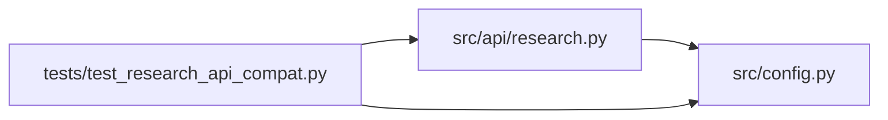

# test_research_api_compat Module

**Path:** `tests/test_research_api_compat.py`

## Description

Research-API backward-compatibility test suite (ARC-011 P3-020, GEN-001/002/004).

Validates the dual-shape guarantee (§10 #1, #4): legacy clients sending
``{instrument, timeframe, model_type}`` still work identically, and every
response carries **both** canonical (``skill_id``/``subject_id``/``variant``)
and legacy (``model_type``/``instrument``/``timeframe``) fields.

## Imports

| Source | Symbols |
|--------|---------|
| `__future__` | `annotations` |
| `fastapi` | `FastAPI` |
| `fastapi.testclient` | `TestClient` |
| `os` | `os` |
| `pytest` | `pytest` |
| `src.api` | `research` |
| `src.api.research` | `router`, `_dual_shape_session` |
| `src.config` | `settings` |
| `typing` | `Any`, `Dict` |

## Local dependency map

<!-- Auto-generated local dependency summary. Do not edit by hand. -->

### Internal neighbors

| Direction | Module |
|---|---|
| Outbound | [research](../modules/research.md) |
| Outbound | [config](../modules/config.md) |

### External packages

| Language | Used packages | Undeclared packages |
|---|---:|---:|
| python | 2 | 2 |

## Classes

| Class | Line | Bases | Description |
|-------|------|-------|-------------|
| [FakeSessionManager](../entities/test_research_api_compat_FakeSessionManager.md) | 29 | — | Minimal stub — returns a canned session dict for start_session. |
| [FakeStore](../entities/test_research_api_compat_FakeStore.md) | 73 | — | — |

## Functions

| Function | Signature | Decorators | Description |
|----------|-----------|------------|-------------|
| `create_test_app` | `() -> FastAPI` | — | — |
| `configure` | `(monkeypatch: pytest.MonkeyPatch)` | `@pytest.fixture(autouse=True)` | — |
| `client` | `() -> TestClient` | `@pytest.fixture` | — |
| `auth_headers` | `() -> dict[str, str]` | — | — |
| `test_legacy_start_of_uninstalled_trio_returns_404_naming_translated_skill` | `(client: TestClient)` | — | ARC-012 P7-010 / D3: a legacy ``{model_type: direction}`` request is |
| `test_legacy_start_of_installed_skill_returns_201_with_dual_shape` | `(client: TestClient)` | — | The legacy shape still starts a session when it names an installed |
| `test_canonical_start_returns_201_with_dual_shape` | `(client: TestClient)` | — | — |
| `test_canonical_start_unknown_skill_returns_404` | `(client: TestClient)` | — | — |
| `test_get_research_returns_dual_shape` | `(client: TestClient)` | — | — |
| `test_both_shapes_canonical_wins` | `(client: TestClient)` | — | — |
| `test_missing_both_shapes_returns_422` | `(client: TestClient)` | — | — |
| `test_conflicting_shapes_canonical_overrides_legacy` | `(client: TestClient)` | — | When skill_id and model_type disagree, canonical (skill_id) wins and |
| `test_conflicting_shapes_recorded_in_audit` | `(client: TestClient)` | — | Conflicts are audited as a warning (P3-013 risk: "warn in audit"). |
| `test_skill_params_valid_passes` | `(client: TestClient)` | — | Valid skill_params (matching the skill's param_schema) → 201. |
| `test_skill_params_unknown_key_returns_422` | `(client: TestClient)` | — | Unknown skill_params key → 422 with field pointer (additionalProperties: |
| `test_skill_params_wrong_type_returns_422` | `(client: TestClient)` | — | Wrong type in skill_params → 422 with field pointer. |
| `test_list_research_items_have_dual_shape` | `(client: TestClient)` | — | GET /research returns items with both canonical and legacy fields |
| `test_pipeline_row_dual_shape_fields` | `()` | — | A pipeline row (``model_type="pipeline"``) is a multi-skill container. |
| `_session_manager` | `() -> FakeSessionManager` | — | — |
| `test_canonical_fields_forwarded_to_session_manager` | `(client: TestClient)` | — | C1: ``{skill_id, subject_id, variant, skill_params}`` survive the trip |
| `test_canonical_params_recorded_in_start_audit` | `(client: TestClient)` | — | C1: the research.start audit metadata now records the winning |
| `test_legacy_start_translates_to_canonical_fields` | `(client: TestClient)` | — | ARC-012 P7-010/D3: a legacy request is translated to the canonical |
