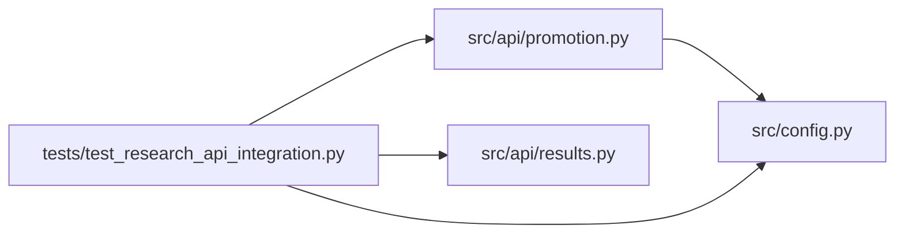

# test_research_api_integration Module

**Path:** `tests/test_research_api_integration.py`

## Description

ARC-011 Phase 3 — HTTP-level integration tests (P3-015/016/017).

The back-compat suite (``test_research_api_compat.py``) covers the dual-shape
session contract. These tests exercise the **live router → helper path
end-to-end** for the enriched iteration + promotion endpoints, which until now
were only covered at the helper-unit level (``_enrich_iteration``,
``_inject_target_kind`` in ``test_generalization_falsifiability.py``).

Covered:

* **P3-015/016** — ``GET /research/{id}/iterations`` returns rows carrying the
  canonical ``skill_id``/``skill_phase``/``evidence_keys`` fields *alongside*
  the legacy ``search_phase`` (the additive canonical surface, §10 guarantee
  #4), exercised through the real FastAPI router.
* **P3-017** — ``POST /research/{id}/promote/preview`` carries ``target_kind``
  derived from the skill manifest's ``promotion_target.primary.kind`` when the
  registry is wired, and defaults to ``file_path`` for legacy sessions when it
  is not.

## Imports

| Source | Symbols |
|--------|---------|
| `__future__` | `annotations` |
| `fastapi` | `FastAPI` |
| `fastapi.testclient` | `TestClient` |
| `os` | `os` |
| `pytest` | `pytest` |
| `src.api` | `promotion`, `results` |
| `src.api.promotion` | `router` |
| `src.api.results` | `router` |
| `src.config` | `settings` |
| `typing` | `Any`, `Dict` |

## Local dependency map

<!-- Auto-generated local dependency summary. Do not edit by hand. -->

### Internal neighbors

| Direction | Module |
|---|---|
| Outbound | [promotion](../modules/promotion.md) |
| Outbound | [results](../modules/results.md) |
| Outbound | [config](../modules/config.md) |

### External packages

| Language | Used packages | Undeclared packages |
|---|---:|---:|
| python | 2 | 2 |

## Classes

| Class | Line | Bases | Description |
|-------|------|-------|-------------|
| [_Store](../entities/Store.md) | 43 | — | Minimal store stub with the session + iteration read surface. |
| [_FakePromoter](../entities/FakePromoter.md) | 108 | — | Returns a canned preview dict; ``target_kind`` is injected downstream. |
| [_StubManifest](../entities/StubManifest.md) | 210 | — | — |
| [_StubRegistry](../entities/StubRegistry.md) | 224 | — | Returns a manifest with a configurable promotion target kind. |

## Functions

| Function | Signature | Decorators | Description |
|----------|-----------|------------|-------------|
| `_create_test_app` | `() -> FastAPI` | — | — |
| `_wire` | `(monkeypatch: pytest.MonkeyPatch)` | `@pytest.fixture(autouse=True)` | — |
| `client` | `() -> TestClient` | `@pytest.fixture` | — |
| `_auth` | `() -> dict[str, str]` | — | — |
| `test_get_iterations_returns_enriched_canonical_fields` | `(client: TestClient)` | — | The live iterations endpoint enriches each row with the canonical |
| `test_promotion_preview_defaults_to_file_path_without_registry` | `(client: TestClient)` | — | With no skill registry wired (legacy session), the preview response |
| `test_promotion_preview_carries_target_kind_from_registry` | `(client: TestClient, kind: str)` | `@pytest.mark.parametrize('kind', ['file_path', 'registry_api', 'git_branch', 'artifact_store'])` | When the skill registry is wired, ``target_kind`` comes from the skill |
| `test_promotion_preview_value_error_surfaces_as_404` | `(client: TestClient)` | — | ARC-012 P7-008: the string-sniffing branch for the deleted "Unknown |
