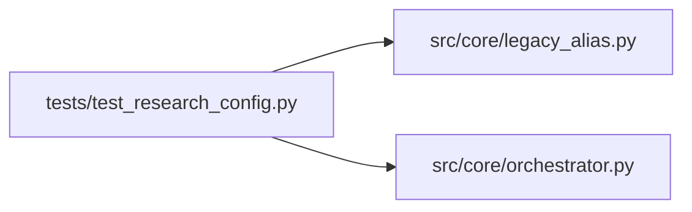

# test_research_config Module

**Path:** `tests/test_research_config.py`

## Description

ResearchConfig generalization tests (ARC-011 P2-020).

Pins the P2-017 behavior: ``ResearchConfig`` accepts both the legacy shape
(``instrument``/``timeframe``/``model_type`` flat fields) and the canonical shape
(``subject_id``/``variant``/``skill_id``), the canonical fields derive from
legacy when unset, the flat ML fields mirror into ``skill_params``, and the
``skill_id`` derivation is deferred to ``materialize_skill_runtime`` (not
``__post_init__``) so legacy sessions keep the transitional runtime.

Also covers P2-019 (``legacy_alias`` ``model_type ↔ skill_id`` round-trips).

## Imports

| Source | Symbols |
|--------|---------|
| `__future__` | `annotations` |
| `pytest` | `pytest` |
| `src.core.legacy_alias` | `is_known_model_type`, `model_type_to_skill_id`, `skill_id_to_model_type` |
| `src.core.orchestrator` | `ResearchConfig` |

## Local dependency map

<!-- Auto-generated local dependency summary. Do not edit by hand. -->

### Internal neighbors

| Direction | Module |
|---|---|
| Outbound | [core_legacy_alias](../modules/core_legacy_alias.md) |
| Outbound | [orchestrator](../modules/orchestrator.md) |

### External packages

| Language | Used packages | Undeclared packages |
|---|---:|---:|
| python | 1 | 1 |

## Functions

| Function | Signature | Decorators | Description |
|----------|-----------|------------|-------------|
| `test_model_type_to_skill_id` | `(model_type: str, skill_id: str)` | `@pytest.mark.parametrize('model_type, skill_id', [('direction', 'ml-direction'), ('volatility', 'ml-volatility'), ('rl', 'ml-rl')])` | — |
| `test_skill_id_to_model_type` | `(model_type: str, skill_id: str)` | `@pytest.mark.parametrize('model_type, skill_id', [('direction', 'ml-direction'), ('volatility', 'ml-volatility'), ('rl', 'ml-rl')])` | — |
| `test_alias_round_trip_is_identity` | `()` | — | — |
| `test_unknown_model_type_is_its_own_skill_id` | `()` | — | Non-legacy values are already canonical skill ids — identity fallback. |
| `test_unknown_skill_id_is_its_own_model_type` | `()` | — | Non-legacy skill ids alias to themselves — dual-shape for every skill. |
| `test_is_known_model_type` | `()` | — | — |
| `test_legacy_shape_construction_works` | `()` | — | Legacy fields (instrument/timeframe/model_type) are still the primary |
| `test_canonical_fields_derive_from_legacy` | `()` | — | subject_id/variant derive from instrument/timeframe when not set. |
| `test_canonical_fields_win_when_explicitly_set` | `()` | — | When subject_id/variant are passed explicitly, they are authoritative. |
| `test_skill_id_stays_empty_by_default` | `()` | — | skill_id is NOT derived in __post_init__ — it stays "" so legacy |
| `test_skill_id_when_explicitly_set` | `()` | — | — |
| `test_skill_params_passed_explicitly_are_preserved` | `()` | — | A caller can pass skill_params directly; it's not overwritten. |
| `test_skill_version_field_exists` | `()` | — | P1-023 (D3): skill_version field is present (default ""). |
| `test_skill_params_initializes_to_dict` | `()` | — | skill_params is always a dict after construction (never None). |
| `test_skill_params_roundtrip` | `()` | — | — |
