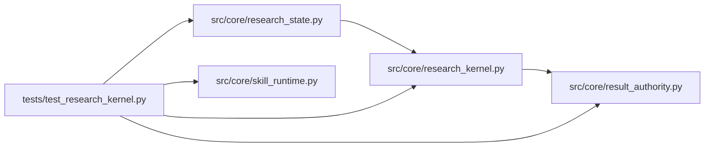

# test_research_kernel Module

**Path:** `tests/test_research_kernel.py`

## Description

Kernel boundary and characterization tests.

The research kernel must complete a research lifecycle with a deterministic
driver and must never depend on provider SDKs or message-block types. The
import-boundary test enforces that harness types cannot leak back into the
kernel, and the parity tests pin the supported decision semantics.

## Imports

| Source | Symbols |
|--------|---------|
| `__future__` | `annotations` |
| `ast` | `ast` |
| `pathlib` | `Path` |
| `pytest` | `pytest` |
| `src.core` | `research_kernel` |
| `src.core.research_kernel` | `AttemptPlan`, `AttemptResult`, `decide_budget`, `decide_objective`, `decide_promotion`, `improves_on_best`, `plan_attempt`, `run_kernel_lifecycle`, `verify_evidence` |
| `src.core.research_state` | `_iteration_budget_reached` |
| `src.core.result_authority` | `issue_result_receipt` |
| `src.core.skill_runtime` | `ManifestSkillRuntime` |
| `types` | `SimpleNamespace` |

## Local dependency map

<!-- Auto-generated local dependency summary. Do not edit by hand. -->

### Internal neighbors

| Direction | Module |
|---|---|
| Outbound | [research_kernel](../modules/research_kernel.md) |
| Outbound | [research_state](../modules/research_state.md) |
| Outbound | [result_authority](../modules/result_authority.md) |
| Outbound | [skill_runtime](../modules/skill_runtime.md) |

### External packages

| Language | Used packages | Undeclared packages |
|---|---:|---:|
| python | 1 | 1 |

## Classes

| Class | Line | Bases | Description |
|-------|------|-------|-------------|
| [DeterministicDriver](../entities/DeterministicDriver.md) | 232 | — | — |

## Functions

| Function | Signature | Decorators | Description |
|----------|-----------|------------|-------------|
| `_imported_modules` | `(path: Path, *, include_local: bool) -> set[str]` | — | — |
| `_transitive_closure` | `(root_module: str) -> set[str]` | — | — |
| `test_kernel_import_closure_excludes_harness_types` | `()` | — | — |
| `test_kernel_module_names_no_provider_symbols` | `()` | — | — |
| `test_budget_parity_with_iteration_budget` | `(max_iterations, count, expected)` | `@pytest.mark.parametrize(('max_iterations', 'count', 'expected'), [(3, 2, False), (3, 3, True), (0, 5, False), (None, 5, False)])` | — |
| `test_budget_labels_report_declared_caps_honestly` | `()` | — | — |
| `test_winner_direction_parity` | `(metric, best, direction, expected)` | `@pytest.mark.parametrize(('metric', 'best', 'direction', 'expected'), [(1.0, 0.5, 'maximize', True), (0.4, 0.5, 'maximize', False), (0.4, 0.5, 'minimize', True), (1.0, 0.5, 'minimize_drawdown', False), (1.0, None, 'minimize', True), (None, 0.5, 'maximize', False)])` | — |
| `test_plan_attempt_scheduling_semantics` | `()` | — | — |
| `test_evidence_parity_with_result_receipt` | `()` | — | — |
| `test_promotion_parity_with_qualification_status` | `()` | — | — |
| `test_kernel_completes_lifecycle_with_deterministic_driver` | `()` | — | — |
| `test_kernel_lifecycle_retries_then_stops_on_consistency_block` | `()` | — | — |
| `test_skill_runtime_host_seam_is_protocol_shaped` | `()` | — | The skill runtime reaches its context only through SkillHostServices. |
