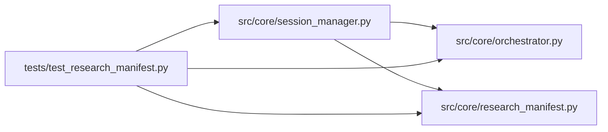

# test_research_manifest Module

**Path:** `tests/test_research_manifest.py`

## Description

_Auto-generated from `tests/test_research_manifest.py`._

## Imports

| Source | Symbols |
|--------|---------|
| `__future__` | `annotations` |
| `json` | `json` |
| `os` | `os` |
| `pytest` | `pytest` |
| `src.core.orchestrator` | `ResearchConfig` |
| `src.core.research_manifest` | `CURRENT_SCHEMA_VERSION`, `ResearchSessionManifest`, `build_research_manifest`, `manifest_pretty_json` |
| `src.core.session_manager` | `SessionManager` |

## Local dependency map

<!-- Auto-generated local dependency summary. Do not edit by hand. -->

### Internal neighbors

| Direction | Module |
|---|---|
| Outbound | [orchestrator](../modules/orchestrator.md) |
| Outbound | [research_manifest](../modules/research_manifest.md) |
| Outbound | [session_manager](../modules/session_manager.md) |

### External packages

| Language | Used packages | Undeclared packages |
|---|---:|---:|
| python | 1 | 1 |

## Functions

| Function | Signature | Decorators | Description |
|----------|-----------|------------|-------------|
| `_build_manifest` | `(**overrides)` | — | — |
| `test_build_research_manifest_has_required_runtime_sections` | `()` | — | — |
| `test_v3_manifest_builds_for_bundled_skills_without_ml_fabrication` | `(skill_id)` | `@pytest.mark.parametrize('skill_id', _BUNDLED_SKILL_IDS)` | P7-002/P7-003 AC: every bundled (non-ML) skill builds a v3 manifest |
| `test_v3_manifest_model_type_alias_accepted_for_legacy_trio` | `()` | — | P7-002 AC: ``build_research_manifest(model_type=...)`` with a legacy |
| `test_v3_model_type_closed_vocabulary` | `(model_type)` | `@pytest.mark.parametrize('model_type', ['direction', 'volatility', 'rl', ''])` | — |
| `test_v3_model_type_rejects_free_text` | `()` | — | D1: the legacy field is a closed vocabulary — a skill id or typo must |
| `test_v3_unknown_skill_rejected_without_fabrication` | `()` | — | A skill id the registry cannot resolve raises instead of fabricating |
| `test_ml_profile_still_requires_ml_sections` | `()` | — | P7-004 regression: a legacy-ML manifest missing ``roster`` fails. |
| `test_skill_profile_does_not_require_ml_sections` | `()` | — | P7-004: a skill-driven manifest validates without the ML-only |
| `test_build_research_manifest_emits_per_session_nonce` | `()` | — | ARC-011 P4-002, revised by review C3 (2026-08-15): the per-session |
| `test_session_manager_nonce_is_out_of_band_and_fresh` | `()` | — | C3: ``SessionManager._build_manifest_payload`` returns a fresh 64-hex |
| `test_manifest_identity_overrides_must_match_request` | `()` | — | — |
| `test_new_manifest_emits_v3` | `()` | — | Newly built manifests carry the current schema version (P7-002). |
| `test_manifest_carries_canonical_dual_shape_fields` | `(model_type, expected_skill_id)` | `@pytest.mark.parametrize('model_type, expected_skill_id', [('direction', 'ml-direction'), ('volatility', 'ml-volatility'), ('rl', 'ml-rl')])` | The v2 manifest artifact is self-describing: canonical fields are |
| `test_v1_manifest_loads_and_normalizes_to_current` | `()` | — | Forward-compat: a v1 manifest persisted before P3-019 loads under the |
| `test_v2_manifest_loads_and_normalizes_to_v3` | `()` | — | P7-002: persisted v2 artifacts (written before the bump) load |
| `test_unknown_schema_version_rejected_with_clear_error` | `()` | — | An unrecognized schema_version prefix is rejected (R3 back-compat — |
| `test_manifest_round_trip_preserves_canonical_fields` | `()` | — | model_dump → re-validate preserves the canonical surface (no field |
