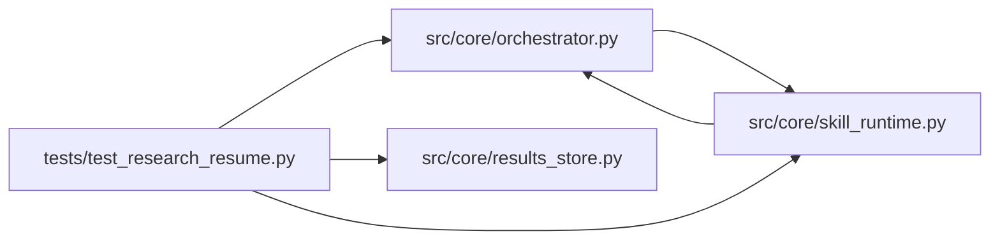

# test_research_resume Module

**Path:** `tests/test_research_resume.py`

## Description

Cross-session research resume: generated at setup, read by prompts.

The resume summarizes prior recorded experiments for the same subject and
variant so sessions build on — rather than repeat — prior work. Generation
runs at session setup (async store access); the sync prompt builders only
read the rendered file.

## Imports

| Source | Symbols |
|--------|---------|
| `__future__` | `annotations` |
| `json` | `json` |
| `pytest` | `pytest` |
| `src.core` | `orchestrator` |
| `src.core.orchestrator` | `AgentOrchestrator`, `ResearchConfig` |
| `src.core.results_store` | `ResultsStore` |
| `src.core.skill_runtime` | `materialize_skill_runtime` |

## Local dependency map

<!-- Auto-generated local dependency summary. Do not edit by hand. -->

### Internal neighbors

| Direction | Module |
|---|---|
| Outbound | [orchestrator](../modules/orchestrator.md) |
| Outbound | [results_store](../modules/results_store.md) |
| Outbound | [skill_runtime](../modules/skill_runtime.md) |

### External packages

| Language | Used packages | Undeclared packages |
|---|---:|---:|
| python | 1 | 1 |

## Functions

| Function | Signature | Decorators | Description |
|----------|-----------|------------|-------------|
| `_config` | `(research_id: str, skill_id: str = 'conformance-probe') -> ResearchConfig` | — | — |
| `_seed_history` | *(async)* `(store: ResultsStore) -> None` | — | — |
| `test_generated_resume_summarizes_prior_experiments` | *(async)* `(tmp_path, monkeypatch)` | `@pytest.mark.asyncio` | — |
| `test_resume_is_empty_without_prior_experiments` | *(async)* `(tmp_path)` | `@pytest.mark.asyncio` | — |
| `test_skill_runtime_resume_helpers_resolve` | *(async)* `(tmp_path)` | `@pytest.mark.asyncio` | — |
