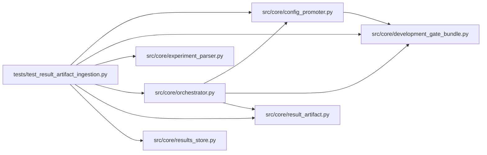

# test_result_artifact_ingestion Module

**Path:** `tests/test_result_artifact_ingestion.py`

## Description

_Auto-generated from `tests/test_result_artifact_ingestion.py`._

## Imports

| Source | Symbols |
|--------|---------|
| `__future__` | `annotations` |
| `anthropic` | `anthropic` |
| `hashlib` | `hashlib` |
| `importlib.util` | `importlib.util` |
| `json` | `json` |
| `os` | `os` |
| `pathlib` | `Path` |
| `pytest` | `pytest` |
| `src.core` | `config_promoter`, `orchestrator` |
| `src.core.config_promoter` | `ConfigPromoter` |
| `src.core.development_gate_bundle` | `evaluate_development_gate_bundle` |
| `src.core.experiment_parser` | `parse_prepare_output` |
| `src.core.orchestrator` | `AgentOrchestrator`, `ResearchConfig` |
| `src.core.result_artifact` | `merge_result_payload`, `merge_result_payload` |
| `src.core.results_store` | `ResultsStore` |
| `sys` | `sys` |
| `types` | `types`, `ModuleType` |
| `typing` | `Any`, `Dict`, `cast` |

## Local dependency map

<!-- Auto-generated local dependency summary. Do not edit by hand. -->

### Internal neighbors

| Direction | Module |
|---|---|
| Outbound | [config_promoter](../modules/config_promoter.md) |
| Outbound | [development_gate_bundle](../modules/development_gate_bundle.md) |
| Outbound | [experiment_parser](../modules/experiment_parser.md) |
| Outbound | [orchestrator](../modules/orchestrator.md) |
| Outbound | [result_artifact](../modules/result_artifact.md) |
| Outbound | [results_store](../modules/results_store.md) |

### External packages

| Language | Used packages | Undeclared packages |
|---|---:|---:|
| python | 2 | 2 |

## Functions

| Function | Signature | Decorators | Description |
|----------|-----------|------------|-------------|
| `_load_prepare_module` | `(relative_path: str, module_name: str)` | — | — |
| `_create_session` | *(async)* `(store: ResultsStore, *, session_id: str, workspace: Path, model_type: str = 'direction') -> None` | — | — |
| `_rich_results_payload` | `(model_path: str = 'runs/model.pkl') -> Dict[str, Any]` | — | — |
| `_base_marker` | `(results_path: Path) -> Dict[str, Any]` | — | — |
| `_sha256` | `(path: Path) -> str` | — | — |
| `test_direction_and_volatility_marker_emit_results_json_path` | `(tmp_path: Path) -> None` | — | — |
| `test_record_iteration_copies_results_and_merges_nested_evidence` | *(async)* `(tmp_path: Path) -> None` | `@pytest.mark.asyncio` | — |
| `test_invalid_result_artifact_path_is_ignored` | *(async)* `(tmp_path: Path) -> None` | `@pytest.mark.asyncio` | — |
| `test_prepare_output_parses_feature_schema_flags_json` | `() -> None` | — | — |
| `test_development_gate_bundle_uses_nested_result_evidence` | `() -> None` | — | — |
| `test_development_gate_bundle_keeps_structural_evidence_required_for_legacy_rows` | `() -> None` | — | — |
| `test_artifact_resolver_prefers_stored_model_path` | `(tmp_path: Path, monkeypatch: pytest.MonkeyPatch) -> None` | — | — |
| `test_merge_result_payload_surfaces_label_levers_as_flat_aliases` | `() -> None` | — | P5/Action 6: label_mode, direction_pct_threshold and atr_barrier_mult from |
| `test_merge_result_payload_carries_regime_gated_replay_nested` | `() -> None` | — | Action 4: economic_replay_regime_gated is a nested result key, merged into |
