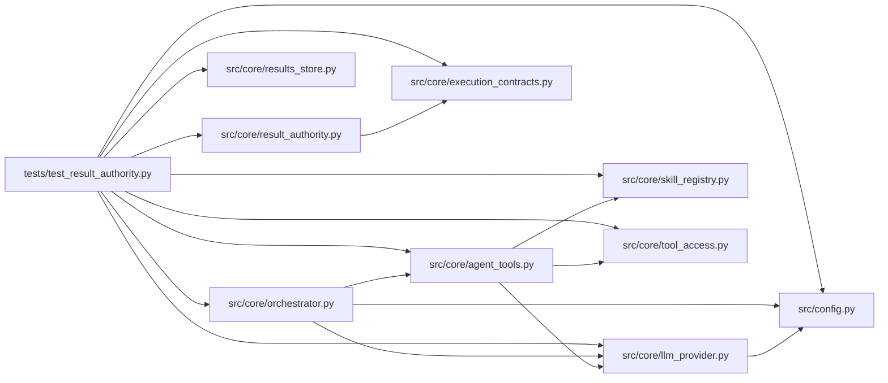

# test_result_authority Module

**Path:** `tests/test_result_authority.py`

## Description

Evaluator-result authority: receipts, provenance labels, and replay tests.

Model-visible nonces never establish authority. These regressions pin the
trusted-evaluator ingestion contract: result content is bound to the
server-created attempt and the exact candidate/evaluator/dataset identities
by a receipt (changing metric, gate, candidate, or attempt identity
invalidates it), repeated delivery of a legitimate receipt creates no new
result, model-authored markers are annotations/proposals that can never
overwrite verified metrics, gate outcomes, or scored candidate snapshots,
and every record carries an honest, never-upgraded provenance label.

## Imports

| Source | Symbols |
|--------|---------|
| `__future__` | `annotations` |
| `hashlib` | `hashlib` |
| `json` | `json` |
| `os` | `os` |
| `pathlib` | `Path` |
| `pytest` | `pytest` |
| `src.config` | `settings` |
| `src.core` | `orchestrator`, `skill_registry` |
| `src.core.agent_tools` | `_execute_tool` |
| `src.core.execution_contracts` | `canonical_digest` |
| `src.core.llm_provider` | `Usage` |
| `src.core.orchestrator` | `AgentOrchestrator`, `ResearchConfig` |
| `src.core.result_authority` | `AUTHORITY_MODEL_PROPOSED`, `AUTHORITY_NONCE_ONLY`, `AUTHORITY_RECEIPT_VERIFIED`, `AUTHORITY_UNVERIFIED_IMPORTED`, `issue_result_receipt`, `result_payload`, `verify_result_receipt`, `protected_result_names` |
| `src.core.results_store` | `ResultsStore` |
| `src.core.skill_registry` | `SkillRegistry` |
| `src.core.tool_access` | `build_tool_access_context` |
| `sys` | `sys` |
| `unittest.mock` | `AsyncMock`, `patch` |
| `yaml` | `yaml` |

## Local dependency map

<!-- Auto-generated local dependency summary. Do not edit by hand. -->

### Internal neighbors

| Direction | Module |
|---|---|
| Outbound | [config](../modules/config.md) |
| Outbound | [agent_tools](../modules/agent_tools.md) |
| Outbound | [execution_contracts](../modules/execution_contracts.md) |
| Outbound | [llm_provider](../modules/llm_provider.md) |
| Outbound | [orchestrator](../modules/orchestrator.md) |
| Outbound | [result_authority](../modules/result_authority.md) |
| Outbound | [results_store](../modules/results_store.md) |
| Outbound | [skill_registry](../modules/skill_registry.md) |
| Outbound | [tool_access](../modules/tool_access.md) |

### External packages

| Language | Used packages | Undeclared packages |
|---|---:|---:|
| python | 2 | 1 |

## Classes

| Class | Line | Bases | Description |
|-------|------|-------|-------------|
| [_Turn](../entities/Turn.md) | 67 | — | One provider response: tool calls and/or assistant text. |
| [_ScriptedProvider](../entities/test_result_authority_ScriptedProvider.md) | 75 | — | Emits a fixed sequence of turns, then terminates. |

## Functions

| Function | Signature | Decorators | Description |
|----------|-----------|------------|-------------|
| `_write_skill` | `(skills_root: Path) -> Path` | — | A schema-valid skill whose evaluator prints a result block and |
| `_run_session` | *(async)* `(monkeypatch, tmp_path: Path, turns: list[_Turn]) -> tuple` | — | Drive one real run() session through the built-in tool loop. |
| `_records` | `(metrics_rows) -> list[dict]` | — | — |
| `_issue` | `(payload = None, **overrides)` | — | — |
| `test_valid_receipt_verifies_clean` | `()` | — | — |
| `receipt_payload` | `(receipt)` | — | Rebuild the payload a receipt binds (for verification calls). |
| `test_changing_metric_or_gate_invalidates_the_receipt` | `(field, value)` | `@pytest.mark.parametrize('field,value', [('primary_metric', 999.0), ('all_gates_passed', 0), ('metric_name', 'other')])` | — |
| `test_changing_candidate_or_attempt_identity_invalidates_the_receipt` | `()` | — | — |
| `test_repeating_a_legitimate_receipt_yields_the_same_id` | `()` | — | — |
| `test_keyed_receipts_use_hmac_and_reject_wrong_keys` | `()` | — | — |
| `test_valid_result_is_receipt_verified_and_binds_the_attempt` | *(async)* `(monkeypatch, tmp_path)` | `@pytest.mark.asyncio` | — |
| `test_model_marker_cannot_overwrite_a_verified_result` | *(async)* `(monkeypatch, tmp_path)` | `@pytest.mark.asyncio` | — |
| `test_forged_snapshot_invalidates_the_recorded_receipt` | *(async)* `(monkeypatch, tmp_path)` | `@pytest.mark.asyncio` | — |
| `test_wrong_attempt_receipt_is_rejected` | *(async)* `(monkeypatch, tmp_path)` | `@pytest.mark.asyncio` | — |
| `test_duplicate_delivery_creates_no_new_result` | *(async)* `(monkeypatch, tmp_path)` | `@pytest.mark.asyncio` | — |
| `test_prior_nonce_replay_never_becomes_authoritative` | *(async)* `(monkeypatch, tmp_path)` | `@pytest.mark.asyncio` | — |
| `test_model_reported_results_are_labeled_as_proposals` | *(async)* `(monkeypatch, tmp_path)` | `@pytest.mark.asyncio` | — |
| `test_result_channel_files_are_not_writable_by_candidate_tools` | `(tmp_path)` | — | — |
