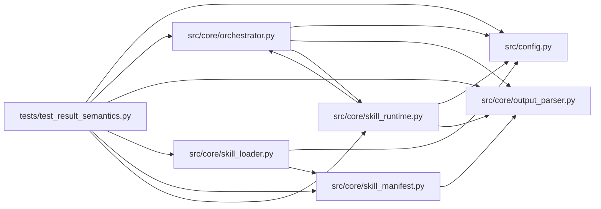

# test_result_semantics Module

**Path:** `tests/test_result_semantics.py`

## Description

Normalized result contract: declared parser semantics, explicit invalid
evidence, and identical rules for stdout and artifact collection.

A result payload either validates against the declared result semantics
(parser format, marker prefix, required fields, field types/units, finite
numbers, schema version, failure statuses) or becomes explicit invalid
evidence — never implicit success and never a promotable placeholder metric.

## Imports

| Source | Symbols |
|--------|---------|
| `__future__` | `annotations` |
| `json` | `json` |
| `math` | `math` |
| `os` | `os` |
| `pathlib` | `Path` |
| `pytest` | `pytest` |
| `src.config` | `settings` |
| `src.core.orchestrator` | `AgentOrchestrator` |
| `src.core.output_parser` | `RESULT_SCHEMA_VERSION`, `ResultSpec`, `extract_raw_result`, `normalize_result`, `parse_and_verify_text`, `parse_result_text` |
| `src.core.skill_loader` | `load_skill_manifest` |
| `src.core.skill_manifest` | `FieldTypes`, `ResearchSkillManifest` |
| `src.core.skill_runtime` | `ManifestSkillRuntime` |
| `types` | `types` |
| `unittest.mock` | `MagicMock` |
| `yaml` | `yaml` |

## Local dependency map

<!-- Auto-generated local dependency summary. Do not edit by hand. -->

### Internal neighbors

| Direction | Module |
|---|---|
| Outbound | [config](../modules/config.md) |
| Outbound | [orchestrator](../modules/orchestrator.md) |
| Outbound | [output_parser](../modules/output_parser.md) |
| Outbound | [skill_loader](../modules/skill_loader.md) |
| Outbound | [skill_manifest](../modules/skill_manifest.md) |
| Outbound | [skill_runtime](../modules/skill_runtime.md) |

### External packages

| Language | Used packages | Undeclared packages |
|---|---:|---:|
| python | 2 | 1 |

## Functions

| Function | Signature | Decorators | Description |
|----------|-----------|------------|-------------|
| `_db_spec` | `() -> ResultSpec` | — | — |
| `test_declared_result_fields_types_and_units_are_enforced` | `() -> None` | — | — |
| `test_declared_failure_status_is_nonwinning_and_not_promotable` | `() -> None` | — | A declared failure keeps no promotable metric (the accepted-payload |
| `test_missing_required_fields_are_rejected_consistently` | `() -> None` | — | — |
| `test_nonfinite_numbers_are_rejected` | `() -> None` | — | — |
| `test_declared_type_mismatches_are_invalid` | `() -> None` | — | — |
| `test_missing_status_and_gates_never_become_success` | `() -> None` | — | — |
| `test_unknown_status_semantics_and_schema_versions_are_invalid` | `() -> None` | — | — |
| `test_marker_parses_among_noise_and_multiple_markers` | `() -> None` | — | — |
| `test_truncated_and_invalid_json_yield_no_result` | `() -> None` | — | — |
| `test_declared_format_and_marker_prefix_are_honored` | `() -> None` | — | — |
| `test_bare_json_is_an_artifact_form_not_an_agent_marker` | `() -> None` | — | — |
| `_runtime_with_marker` | `(marker: str, require_signed: bool = True) -> ManifestSkillRuntime` | — | — |
| `test_custom_marker_parses_through_the_runtime` | `() -> None` | — | — |
| `test_signed_and_unsigned_imported_results` | `() -> None` | — | — |
| `test_unknown_field_type_declarations_are_rejected_at_load` | `() -> None` | — | — |
| `test_stale_fallback_files_are_ignored` | `(tmp_path: Path, monkeypatch) -> None` | — | A marker file older than the command start is stale evidence. |
