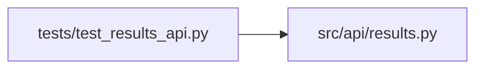

# test_results_api Module

**Path:** `tests/test_results_api.py`

## Description

_Auto-generated from `tests/test_results_api.py`._

## Imports

| Source | Symbols |
|--------|---------|
| `__future__` | `annotations` |
| `json` | `json` |
| `pathlib` | `Path` |
| `pytest` | `pytest` |
| `src.api` | `results` |

## Local dependency map

<!-- Auto-generated local dependency summary. Do not edit by hand. -->

### Internal neighbors

| Direction | Module |
|---|---|
| Outbound | [results](../modules/results.md) |

### External packages

| Language | Used packages | Undeclared packages |
|---|---:|---:|
| python | 1 | 1 |

## Classes

| Class | Line | Bases | Description |
|-------|------|-------|-------------|
| [FakeStore](../entities/test_results_api_FakeStore.md) | 11 | — | — |

## Functions

| Function | Signature | Decorators | Description |
|----------|-----------|------------|-------------|
| `_write_jsonl` | `(path: Path, entries: list[dict]) -> None` | — | — |
| `test_pipeline_agent_log_uses_phase_sessions_and_download` | *(async)* `(tmp_path: Path)` | `@pytest.mark.asyncio` | — |
| `test_pipeline_agent_log_is_empty_before_first_phase` | *(async)* `()` | `@pytest.mark.asyncio` | — |
| `test_pipeline_results_expose_promotion_blockers` | *(async)* `()` | `@pytest.mark.asyncio` | — |
| `test_hpo_studies_decode_structured_plan_fields` | *(async)* `()` | `@pytest.mark.asyncio` | — |
| `test_iteration_enrichment_normalizes_artifact_reference_sentinels` | `()` | — | — |
| `test_research_state_endpoint_reconstructs_session_without_workspace` | *(async)* `()` | `@pytest.mark.asyncio` | — |
| `test_research_state_exposes_production_operations_summary` | *(async)* `()` | `@pytest.mark.asyncio` | — |
| `test_research_state_exposes_structured_promotion_blocker_details` | *(async)* `()` | `@pytest.mark.asyncio` | — |
