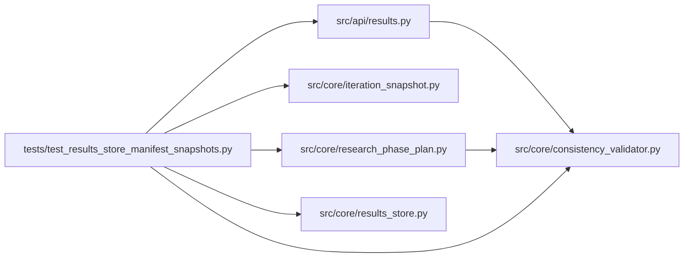

# test_results_store_manifest_snapshots Module

**Path:** `tests/test_results_store_manifest_snapshots.py`

## Description

_Auto-generated from `tests/test_results_store_manifest_snapshots.py`._

## Imports

| Source | Symbols |
|--------|---------|
| `__future__` | `annotations` |
| `json` | `json` |
| `os` | `os` |
| `pathlib` | `Path` |
| `pytest` | `pytest` |
| `src.api.results` | `_enrich_iteration` |
| `src.core.consistency_validator` | `build_consistency_report` |
| `src.core.iteration_snapshot` | `build_trial_identity`, `trial_identity_hash` |
| `src.core.research_phase_plan` | `phase_state_json` |
| `src.core.results_store` | `ResultsStore` |

## Local dependency map

<!-- Auto-generated local dependency summary. Do not edit by hand. -->

### Internal neighbors

| Direction | Module |
|---|---|
| Outbound | [results](../modules/results.md) |
| Outbound | [consistency_validator](../modules/consistency_validator.md) |
| Outbound | [iteration_snapshot](../modules/iteration_snapshot.md) |
| Outbound | [research_phase_plan](../modules/research_phase_plan.md) |
| Outbound | [results_store](../modules/results_store.md) |

### External packages

| Language | Used packages | Undeclared packages |
|---|---:|---:|
| python | 1 | 1 |

## Functions

| Function | Signature | Decorators | Description |
|----------|-----------|------------|-------------|
| `test_results_store_persists_manifest_and_attempt_snapshot` | *(async)* `(tmp_path: Path)` | `@pytest.mark.asyncio` | — |
| `test_results_store_finds_duplicate_trial_identity_by_scope` | *(async)* `(tmp_path: Path)` | `@pytest.mark.asyncio` | — |
| `test_results_store_records_audit_events` | *(async)* `(tmp_path: Path)` | `@pytest.mark.asyncio` | — |
