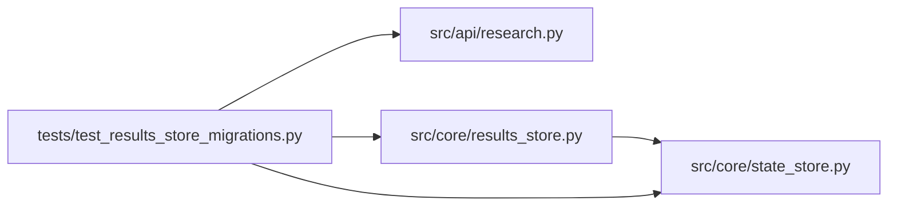

# test_results_store_migrations Module

**Path:** `tests/test_results_store_migrations.py`

## Description

Tests for ARC-011 P0-008 / P0-009 / P0-010 — migration error surfacing.

P0-009's target (a bare ``try/except Exception: pass`` over ``ALTER TABLE``)
was already removed in commit 3c47c1e34 (Phase 1.3 hardening) and replaced
with ``_add_column_if_missing`` — a ``PRAGMA table_info`` pre-check (LBYL)
that lets genuine ``OperationalError`` propagate. These tests pin that
behavior, the migration runner's idempotency, the version-skew guard, and the
ARC-011 P0-008 de-duplication (evolutionary columns live in the migration as
the single source of truth, not the bootstrap ``_SCHEMA_SQL``).

## Imports

| Source | Symbols |
|--------|---------|
| `__future__` | `annotations` |
| `aiosqlite` | `aiosqlite` |
| `logging` | `logging` |
| `os` | `os` |
| `pathlib` | `Path` |
| `pytest` | `pytest` |
| `src.api.research` | `_dual_shape_session` |
| `src.core.results_store` | `_LATEST_SCHEMA_VERSION`, `ResultsStore`, `_add_column_if_missing`, `_set_schema_version` |
| `src.core.state_store` | `_MIGRATIONS`, `_SCHEMA_SQL`, `_get_schema_version`, `_migrate_to_v1` |
| `sys` | `sys` |

## Local dependency map

<!-- Auto-generated local dependency summary. Do not edit by hand. -->

### Internal neighbors

| Direction | Module |
|---|---|
| Outbound | [research](../modules/research.md) |
| Outbound | [results_store](../modules/results_store.md) |
| Outbound | [state_store](../modules/state_store.md) |

### External packages

| Language | Used packages | Undeclared packages |
|---|---:|---:|
| python | 2 | 2 |

## Functions

| Function | Signature | Decorators | Description |
|----------|-----------|------------|-------------|
| `test_add_column_if_missing_is_idempotent` | *(async)* `(tmp_path: Path) -> None` | `@pytest.mark.asyncio` | — |
| `test_add_column_if_missing_propagates_real_errors` | *(async)* `(tmp_path: Path) -> None` | `@pytest.mark.asyncio` | — |
| `test_initialize_is_idempotent` | *(async)* `(tmp_path: Path) -> None` | `@pytest.mark.asyncio` | initialize() twice (same store re-runs, and a reopened DB) is a no-op. |
| `test_initialize_rejects_newer_schema` | *(async)* `(tmp_path: Path) -> None` | `@pytest.mark.asyncio` | A schema_version newer than supported must fail loudly, not silently migrate. |
| `test_fresh_db_migrates_to_latest_with_evolutionary_columns` | *(async)* `(tmp_path: Path) -> None` | `@pytest.mark.asyncio` | A fresh DB reaches the latest version and the evolutionary columns that |
| `test_v6_migration_adds_canonical_skill_columns` | *(async)* `(tmp_path: Path) -> None` | `@pytest.mark.asyncio` | P3-019: v6 migration adds ``skill_id``, ``subject_id``, ``variant`` |
| `test_v1_to_latest_forward_migration_dual_shape` | *(async)* `(tmp_path: Path) -> None` | `@pytest.mark.asyncio` | A DB seeded at v1 (pre-ARC-011 canonical columns) migrates forward to |
| `test_migration_chain_is_logged` | *(async)* `(tmp_path: Path, caplog) -> None` | `@pytest.mark.asyncio` | P3-019 AC: migration is logged. The generic runner emits one info log |
