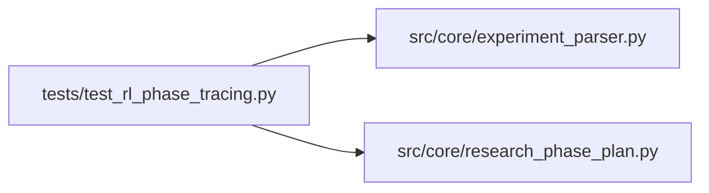

# test_rl_phase_tracing Module

**Path:** `tests/test_rl_phase_tracing.py`

## Description

RL progress-tracing fixes (issue #3 from RL-TRAINING-ISSUES-ANALYSIS).

Regression coverage for the live defect on res_76d405b8caf9, where an RL
session whose iterations had FAILED still fast-forwarded its reported stage to
``promotion_proposal`` with a phantom ``composite_rl_score=0.0`` metric.

Three independent fixes are exercised:
  3a-i   failed iterations do not count toward phase-advancement cardinality
  3a-ii  ``hpo_screening`` requires a genuinely completed (or disabled) HPO
         study, not a merely ``planned`` one
  3a-iii RL ``validation`` requires real RL-OOS evidence on two attempts
  3b-i   a failed run's placeholder ``primary_metric: 0.0`` is nulled by the
         parser so it cannot masquerade as a result

## Imports

| Source | Symbols |
|--------|---------|
| `__future__` | `annotations` |
| `json` | `json` |
| `src.core.experiment_parser` | `parse_prepare_output` |
| `src.core.research_phase_plan` | `build_phase_state` |

## Local dependency map

<!-- Auto-generated local dependency summary. Do not edit by hand. -->

### Internal neighbors

| Direction | Module |
|---|---|
| Outbound | [experiment_parser](../modules/experiment_parser.md) |
| Outbound | [research_phase_plan](../modules/research_phase_plan.md) |

## Functions

| Function | Signature | Decorators | Description |
|----------|-----------|------------|-------------|
| `_phase_status` | `(state: dict, phase_id: str) -> str` | — | — |
| `_failed_rl_iter` | `(iteration: int, phase: str) -> dict` | — | An RL iteration recorded after a failed prepare.py run. |
| `_ok_rl_iter` | `(iteration: int, phase: str, sharpe: float = 0.12) -> dict` | — | A successful RL walk-forward iteration carrying OOS evidence keys. |
| `_planned_study` | `() -> dict` | — | — |
| `_completed_study` | `() -> dict` | — | — |
| `test_failed_rl_iterations_do_not_complete_baseline_or_validation` | `() -> None` | — | — |
| `test_live_repro_two_failed_plus_one_success_is_not_promotion_proposal` | `() -> None` | — | The res_76d405b8caf9 shape: 2 failed + 1 successful RL iter + a planned |
| `test_planned_hpo_study_does_not_complete_hpo_screening` | `() -> None` | — | — |
| `test_completed_hpo_study_completes_hpo_screening` | `() -> None` | — | — |
| `test_disabled_hpo_study_does_not_block_hpo_screening` | `() -> None` | — | — |
| `test_manual_screening_completes_hpo_screening_with_only_planned_study` | `() -> None` | — | enable_hpo=true persists a ``planned`` study, but the agent may do manual |
| `test_planned_study_with_failed_screening_iters_does_not_complete` | `() -> None` | — | Guard against re-opening the false-advance bug: a planned study plus only |
| `test_no_hpo_study_does_not_park_at_hpo_screening` | `() -> None` | — | A no-HPO RL session persists NO study row (orchestrator only plans HPO |
| `test_rl_validation_completes_with_two_oos_iterations` | `() -> None` | — | — |
| `test_rl_validation_blocks_without_oos_evidence` | `() -> None` | — | Two successful-but-contentless iterations (no RL OOS keys) must not |
| `test_parser_nulls_primary_metric_on_failure_status` | `() -> None` | — | — |
| `test_parser_keeps_primary_metric_on_success` | `() -> None` | — | — |
| `test_parser_nulls_metric_for_each_failure_status` | `() -> None` | — | — |
