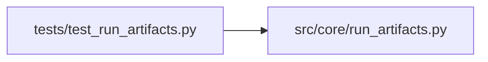

# test_run_artifacts Module

**Path:** `tests/test_run_artifacts.py`

## Description

Content-addressed artifacts: bundles, safe imports, atomic retention.

Multi-file candidate bundles round-trip exactly, tampered objects are
detected, symlinks and archive traversal cannot widen imported roots, and
cleanup/retention respect live references even when interrupted.

## Imports

| Source | Symbols |
|--------|---------|
| `__future__` | `annotations` |
| `io` | `io` |
| `pytest` | `pytest` |
| `src.core.run_artifacts` | `ArtifactError`, `ArtifactLimits`, `ArtifactStore`, `bundle_digest`, `snapshot_parent_workspace` |
| `tarfile` | `tarfile` |
| `zipfile` | `zipfile` |

## Local dependency map

<!-- Auto-generated local dependency summary. Do not edit by hand. -->

### Internal neighbors

| Direction | Module |
|---|---|
| Outbound | [run_artifacts](../modules/run_artifacts.md) |

### External packages

| Language | Used packages | Undeclared packages |
|---|---:|---:|
| python | 1 | 1 |

## Functions

| Function | Signature | Decorators | Description |
|----------|-----------|------------|-------------|
| `_store` | `(tmp_path, **limit_kwargs) -> ArtifactStore` | — | — |
| `test_multi_file_bundle_round_trips_exactly` | `(tmp_path)` | — | — |
| `test_tampered_objects_are_detected_never_used` | `(tmp_path)` | — | — |
| `test_import_tree_refuses_symlinks` | `(tmp_path)` | — | — |
| `test_archive_traversal_and_links_cannot_widen_the_root` | `(tmp_path)` | — | — |
| `test_import_limits_are_enforced` | `(tmp_path)` | — | — |
| `test_partial_writes_are_cleaned_and_never_visible` | `(tmp_path)` | — | — |
| `test_retention_respects_live_references_and_resumes` | `(tmp_path)` | — | — |
| `test_parent_snapshot_is_a_bounded_reference` | `(tmp_path)` | — | — |
