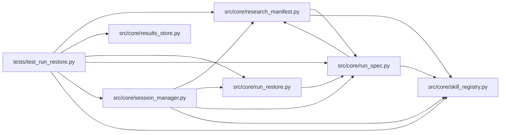

# test_run_restore Module

**Path:** `tests/test_run_restore.py`

## Description

Run restore: pinned-contract reconstruction and explicit recovery states.

A restore must reproduce the recorded scorer, dataset, model configuration,
fixed parameters, limits, and objective policy exactly. Anything that cannot
satisfy the pinned contract — a missing artifact, an unbound credential, a
changed registry, a tampered spec — produces an actionable recovery state,
never a fresh run disguised as a resume.

## Imports

| Source | Symbols |
|--------|---------|
| `__future__` | `annotations` |
| `asyncio` | `asyncio` |
| `json` | `json` |
| `pathlib` | `Path` |
| `pytest` | `pytest` |
| `src.core.research_manifest` | `build_research_manifest` |
| `src.core.results_store` | `ResultsStore` |
| `src.core.run_restore` | `BLOCKER_MANIFEST_UNREADABLE`, `BLOCKER_MISSING_ARTIFACT`, `BLOCKER_MISSING_CREDENTIAL`, `BLOCKER_SKILL_DRIFT`, `BLOCKER_SPEC_TAMPERED`, `RECOVERY_KINDS`, `RecoveryRequired`, `assess_recovery`, `raise_unless_ready`, `restore_contract` |
| `src.core.run_spec` | `build_run_spec`, `skill_package_dir` |
| `src.core.session_manager` | `SessionManager` |
| `src.core.skill_registry` | `default_registry` |

## Local dependency map

<!-- Auto-generated local dependency summary. Do not edit by hand. -->

### Internal neighbors

| Direction | Module |
|---|---|
| Outbound | [research_manifest](../modules/research_manifest.md) |
| Outbound | [results_store](../modules/results_store.md) |
| Outbound | [run_restore](../modules/run_restore.md) |
| Outbound | [run_spec](../modules/run_spec.md) |
| Outbound | [session_manager](../modules/session_manager.md) |
| Outbound | [skill_registry](../modules/skill_registry.md) |

### External packages

| Language | Used packages | Undeclared packages |
|---|---:|---:|
| python | 1 | 1 |

## Classes

| Class | Line | Bases | Description |
|-------|------|-------|-------------|
| [_FakeArtifactStore](../entities/FakeArtifactStore.md) | 105 | — | — |

## Functions

| Function | Signature | Decorators | Description |
|----------|-----------|------------|-------------|
| `_stop_manager_background_tasks` | `()` | `@pytest.fixture(autouse=True)` | — |
| `_pinned_spec` | `(*, skill_version = None, params = None, parent_snapshot = None) -> dict` | — | — |
| `test_contract_extraction_reports_pinned_values` | `()` | — | — |
| `test_pause_and_harness_resume_never_block_on_contract` | `()` | — | — |
| `test_missing_artifact_is_an_actionable_blocker` | `()` | — | — |
| `test_missing_credential_names_the_binding` | `()` | — | — |
| `test_skill_drift_is_an_actionable_blocker` | `()` | — | — |
| `_create_parent` | *(async)* `(store: ResultsStore, *, session_id: str, workspace: Path, run_spec: dict \| None = None, raw_manifest: dict \| None = None) -> None` | — | — |
| `_manager` | `(store: ResultsStore) -> SessionManager` | — | — |
| `test_restart_resume_reproduces_nondefault_contract` | *(async)* `(tmp_path: Path, monkeypatch)` | `@pytest.mark.asyncio` | — |
| `test_changed_registry_requires_explicit_migration` | *(async)* `(tmp_path: Path, monkeypatch)` | `@pytest.mark.asyncio` | — |
| `test_missing_credential_reference_is_actionable` | *(async)* `(tmp_path: Path, monkeypatch)` | `@pytest.mark.asyncio` | — |
| `test_unreadable_checkpoint_is_actionable` | *(async)* `(tmp_path: Path, monkeypatch)` | `@pytest.mark.asyncio` | — |
| `test_duplicate_resume_is_refused` | *(async)* `(tmp_path: Path, monkeypatch)` | `@pytest.mark.asyncio` | — |
| `test_pause_resume_stays_in_place` | *(async)* `(tmp_path: Path, monkeypatch)` | `@pytest.mark.asyncio` | — |
| `test_missing_snapshot_artifact_produces_recovery_state` | *(async)* `(tmp_path: Path, monkeypatch)` | `@pytest.mark.asyncio` | — |
