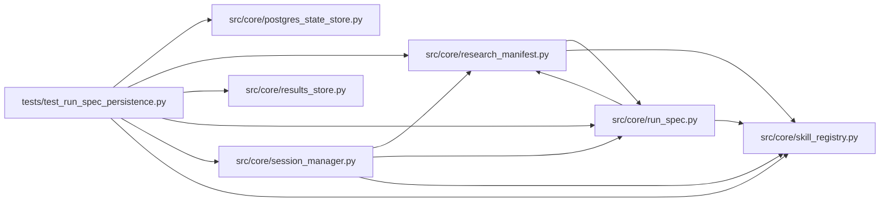

# test_run_spec_persistence Module

**Path:** `tests/test_run_spec_persistence.py`

## Description

Resolved run spec persistence: round-trip, migrations, legacy read.

A run's immutable inputs — canonical parameters and defaults, objective and
policy, evaluator/dataset/package content digests, runtime identity, and the
effective nonsecret configuration — are persisted as a hashed, versioned
run spec that is inspected independently of the current registry and
settings. Secret parameters persist as references with an explicit rebinding
policy, never as values. Old artifacts without a spec report missing
provenance; unknown fields are reported, never backfilled.

## Imports

| Source | Symbols |
|--------|---------|
| `__future__` | `annotations` |
| `aiosqlite` | `aiosqlite` |
| `asyncpg` | `asyncpg` |
| `json` | `json` |
| `os` | `os` |
| `pytest` | `pytest` |
| `src.core` | `skill_registry` |
| `src.core.postgres_state_store` | `PostgresStateStore` |
| `src.core.research_manifest` | `build_research_manifest`, `load_persisted_manifest`, `manifest_pretty_json` |
| `src.core.results_store` | `ResultsStore` |
| `src.core.run_spec` | `SECRET_REBIND_POLICY`, `build_run_spec`, `provenance_report`, `split_secret_params`, `verify_run_spec` |
| `src.core.session_manager` | `SessionManager` |
| `uuid` | `_uuid` |

## Local dependency map

<!-- Auto-generated local dependency summary. Do not edit by hand. -->

### Internal neighbors

| Direction | Module |
|---|---|
| Outbound | [postgres_state_store](../modules/postgres_state_store.md) |
| Outbound | [research_manifest](../modules/research_manifest.md) |
| Outbound | [results_store](../modules/results_store.md) |
| Outbound | [run_spec](../modules/run_spec.md) |
| Outbound | [session_manager](../modules/session_manager.md) |
| Outbound | [skill_registry](../modules/skill_registry.md) |

### External packages

| Language | Used packages | Undeclared packages |
|---|---:|---:|
| python | 3 | 2 |

## Functions

| Function | Signature | Decorators | Description |
|----------|-----------|------------|-------------|
| `_spec` | `(**overrides)` | — | — |
| `test_run_spec_records_params_defaults_digests_and_identity` | `(tmp_path)` | — | — |
| `test_secret_values_are_never_persisted` | `(tmp_path)` | — | — |
| `test_manifest_round_trips_the_run_spec` | `(tmp_path, monkeypatch)` | — | — |
| `test_old_run_artifacts_report_unknown_fields_and_missing_provenance` | `()` | — | — |
| `test_invalid_artifacts_report_instead_of_raising` | `()` | — | — |
| `_migrated_store` | *(async)* `(tmp_path)` | — | A v6-era database copy, migrated forward by the current code. |
| `test_sqlite_migration_adds_secret_refs_on_a_legacy_database` | *(async)* `(tmp_path)` | `@pytest.mark.asyncio` | — |
| `test_secret_refs_cascade_delete_with_the_session` | *(async)* `(tmp_path)` | `@pytest.mark.asyncio` | — |
| `test_postgres_store_carries_the_secret_refs_contract` | *(async)* `()` | `@pytest.mark.asyncio` | — |
| `test_registry_mutation_after_start_keeps_the_pinned_spec` | `(tmp_path)` | — | — |
| `test_skill_pin_refuses_silent_drift` | `()` | — | — |
| `test_continuation_restores_pinned_parameters_and_rebinds_secrets` | `(monkeypatch)` | — | — |
| `test_provenance_report_names_what_is_recorded_and_lacking` | `()` | — | — |
