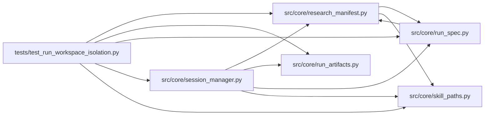

# test_run_workspace_isolation Module

**Path:** `tests/test_run_workspace_isolation.py`

## Description

Run workspace isolation: unique roots and retained parent references.

Fresh runs of the same skill/subject/variant get distinct run roots, so a
later run can never replace or archive an older run's artifacts; continuations
reuse their parent's root deliberately and carry a content-addressed parent
snapshot as the retained reference.

## Imports

| Source | Symbols |
|--------|---------|
| `__future__` | `annotations` |
| `asyncio` | `asyncio` |
| `pathlib` | `Path` |
| `pytest` | `pytest` |
| `src.core` | `session_manager`, `session_manager` |
| `src.core.research_manifest` | `build_research_manifest` |
| `src.core.run_artifacts` | `ArtifactStore` |
| `src.core.run_spec` | `verify_run_spec` |
| `src.core.session_manager` | `SessionManager`, `_derive_workspace_path` |
| `src.core.skill_paths` | `session_workspace_path` |

## Local dependency map

<!-- Auto-generated local dependency summary. Do not edit by hand. -->

### Internal neighbors

| Direction | Module |
|---|---|
| Outbound | [research_manifest](../modules/research_manifest.md) |
| Outbound | [run_artifacts](../modules/run_artifacts.md) |
| Outbound | [run_spec](../modules/run_spec.md) |
| Outbound | [session_manager](../modules/session_manager.md) |
| Outbound | [skill_paths](../modules/skill_paths.md) |

### External packages

| Language | Used packages | Undeclared packages |
|---|---:|---:|
| python | 1 | 1 |

## Classes

| Class | Line | Bases | Description |
|-------|------|-------|-------------|
| [_Workspace](../entities/Workspace.md) | 20 | — | — |
| [_Skill](../entities/Skill.md) | 24 | — | — |

## Functions

| Function | Signature | Decorators | Description |
|----------|-----------|------------|-------------|
| `test_same_subject_runs_get_distinct_run_roots` | `()` | — | — |
| `test_fresh_run_never_archives_an_older_runs_workspace` | `(tmp_path, monkeypatch)` | — | — |
| `test_continuation_records_a_retained_parent_reference` | `(tmp_path, monkeypatch)` | — | — |
| `test_parent_snapshot_lives_in_the_hashed_run_spec` | `()` | — | — |
