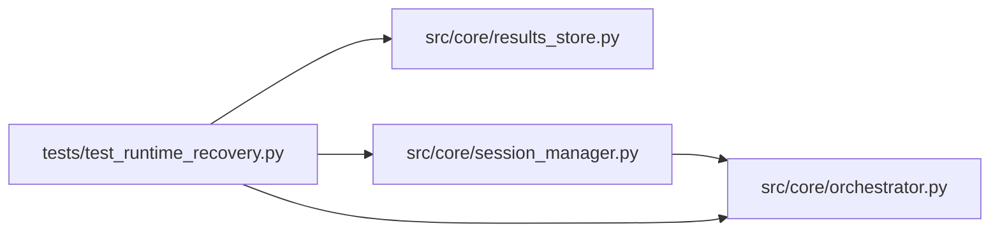

# test_runtime_recovery Module

**Path:** `tests/test_runtime_recovery.py`

## Description

_Auto-generated from `tests/test_runtime_recovery.py`._

## Imports

| Source | Symbols |
|--------|---------|
| `__future__` | `annotations` |
| `anthropic` | `anthropic` |
| `asyncio` | `asyncio` |
| `json` | `json` |
| `os` | `os` |
| `pathlib` | `Path` |
| `pytest` | `pytest` |
| `src.core.orchestrator` | `AgentOrchestrator` |
| `src.core.results_store` | `ResultsStore` |
| `src.core.session_manager` | `SessionManager` |
| `sys` | `sys` |
| `types` | `types` |

## Local dependency map

<!-- Auto-generated local dependency summary. Do not edit by hand. -->

### Internal neighbors

| Direction | Module |
|---|---|
| Outbound | [orchestrator](../modules/orchestrator.md) |
| Outbound | [results_store](../modules/results_store.md) |
| Outbound | [session_manager](../modules/session_manager.md) |

### External packages

| Language | Used packages | Undeclared packages |
|---|---:|---:|
| python | 2 | 2 |

## Classes

| Class | Line | Bases | Description |
|-------|------|-------|-------------|
| [_FakeAsyncAnthropic](../entities/test_runtime_recovery_FakeAsyncAnthropic.md) | 18 | — | — |
| [_FakeAPIStatusError](../entities/test_runtime_recovery_FakeAPIStatusError.md) | 22 | `Exception` | — |

## Functions

| Function | Signature | Decorators | Description |
|----------|-----------|------------|-------------|
| `_create_session` | *(async)* `(store: ResultsStore, *, session_id: str, workspace: Path) -> None` | — | — |
| `test_orphaned_running_session_becomes_resumable` | *(async)* `(tmp_path: Path)` | `@pytest.mark.asyncio` | — |
| `test_runtime_resume_requires_operator_and_creates_chained_session` | *(async)* `(tmp_path: Path)` | `@pytest.mark.asyncio` | — |
| `test_timeout_attempt_snapshot_remains_inspectable` | *(async)* `(tmp_path: Path)` | `@pytest.mark.asyncio` | — |
