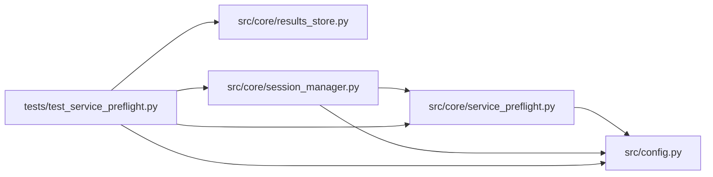

# test_service_preflight Module

**Path:** `tests/test_service_preflight.py`

## Description

_Auto-generated from `tests/test_service_preflight.py`._

## Imports

| Source | Symbols |
|--------|---------|
| `__future__` | `annotations` |
| `anthropic` | `anthropic` |
| `asyncio` | `asyncio` |
| `httpx` | `httpx` |
| `json` | `json` |
| `pathlib` | `Path` |
| `pytest` | `pytest` |
| `src.config` | `settings` |
| `src.core.results_store` | `ResultsStore` |
| `src.core.service_preflight` | `ServicePreflightError`, `require_preflight_ready`, `run_service_preflight`, `sanitize_service_url`, `ServicePreflightTarget` |
| `src.core.session_manager` | `session_manager_module`, `session_manager_module` |
| `sys` | `sys` |
| `types` | `types`, `ModuleType` |
| `typing` | `cast` |

## Local dependency map

<!-- Auto-generated local dependency summary. Do not edit by hand. -->

### Internal neighbors

| Direction | Module |
|---|---|
| Outbound | [config](../modules/config.md) |
| Outbound | [results_store](../modules/results_store.md) |
| Outbound | [service_preflight](../modules/service_preflight.md) |
| Outbound | [session_manager](../modules/session_manager.md) |

### External packages

| Language | Used packages | Undeclared packages |
|---|---:|---:|
| python | 3 | 2 |

## Classes

| Class | Line | Bases | Description |
|-------|------|-------|-------------|
| [_FakeAsyncAnthropic](../entities/test_service_preflight_FakeAsyncAnthropic.md) | 17 | — | — |
| [_FakeAPIStatusError](../entities/test_service_preflight_FakeAPIStatusError.md) | 21 | `Exception` | — |

## Functions

| Function | Signature | Decorators | Description |
|----------|-----------|------------|-------------|
| `_configure_preflight` | `(monkeypatch: pytest.MonkeyPatch, tmp_path: Path) -> None` | — | — |
| `_sample_targets` | `()` | — | — |
| `_healthy_transport` | `() -> httpx.MockTransport` | — | — |
| `test_service_preflight_records_healthy_services` | *(async)* `(monkeypatch, tmp_path)` | `@pytest.mark.asyncio` | — |
| `test_service_preflight_blocks_unhealthy_required_service` | *(async)* `(monkeypatch, tmp_path)` | `@pytest.mark.asyncio` | — |
| `test_session_start_persists_preflight_in_manifest` | *(async)* `(monkeypatch, tmp_path)` | `@pytest.mark.asyncio` | — |
| `test_session_start_preflight_failure_skips_llm_call` | *(async)* `(monkeypatch, tmp_path)` | `@pytest.mark.asyncio` | — |
| `test_sanitize_service_url_removes_manifest_credentials` | `()` | — | — |
