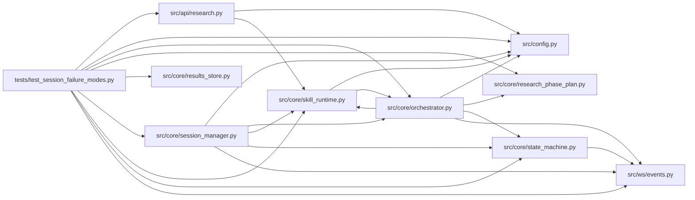

# test_session_failure_modes Module

**Path:** `tests/test_session_failure_modes.py`

## Description

AR-10: End-to-end replay tests for the res_a1ba6cbd520f failure mode,
plus the ARC-012 Wave-2 session failure-semantics suite (P7-009/P7-010;
see the Wave-2 section at the bottom of this file).

Locks in the combined defensive behaviour of AR-1 + AR-3 + AR-5 + AR-6 + AR-7
against the realistic iteration shapes from the broken session.  Every test
uses the ``replay_iterations`` fixture (AR-9) as its data source rather than
hand-building rows.

Four scenarios:

1. D1 crash guard (AR-1): config_snapshot arrives as a dict — _record_iteration
   must not raise and must store it as a JSON string in the DB.

2. D4 inheritance + consistency (AR-3): promotion_proposal iteration without
   config_snapshot auto-inherits from iter-90; consistency report must drop the
   missing_config_snapshot blocker.

3. D3 phase-plan integrity (AR-5/AR-6): synthetic multi_seed_robustness and
   inference_parity_replay iterations (iters 95/97/99) must not advance their
   respective phases past the current position.

4. D7 stagnation nudge (AR-7): after 13 iterations at the same metric, the
   stagnation check must return a GLOBAL_STAGNATION nudge (not None).

## Imports

| Source | Symbols |
|--------|---------|
| `__future__` | `annotations` |
| `anthropic` | `anthropic` |
| `asyncio` | `asyncio` |
| `fastapi` | `FastAPI` |
| `httpx` | `httpx` |
| `json` | `json` |
| `pathlib` | `Path` |
| `pytest` | `pytest` |
| `src.api` | `research` |
| `src.api.research` | `router` |
| `src.config` | `settings` |
| `src.core.orchestrator` | `AgentOrchestrator`, `ResearchConfig` |
| `src.core.research_phase_plan` | `build_phase_state` |
| `src.core.results_store` | `ResultsStore` |
| `src.core.session_manager` | `session_manager_module` |
| `src.core.skill_runtime` | `SkillConfigError` |
| `src.core.state_machine` | `SessionEvent`, `SessionStateMachine` |
| `src.ws.events` | `broadcaster` |
| `sys` | `sys` |
| `time` | `time` |
| `types` | `types`, `ModuleType` |
| `typing` | `Any`, `Dict`, `cast` |

## Local dependency map

<!-- Auto-generated local dependency summary. Do not edit by hand. -->

### Internal neighbors

| Direction | Module |
|---|---|
| Outbound | [research](../modules/research.md) |
| Outbound | [config](../modules/config.md) |
| Outbound | [orchestrator](../modules/orchestrator.md) |
| Outbound | [research_phase_plan](../modules/research_phase_plan.md) |
| Outbound | [results_store](../modules/results_store.md) |
| Outbound | [session_manager](../modules/session_manager.md) |
| Outbound | [skill_runtime](../modules/skill_runtime.md) |
| Outbound | [state_machine](../modules/state_machine.md) |
| Outbound | [events](../modules/events.md) |

### External packages

| Language | Used packages | Undeclared packages |
|---|---:|---:|
| python | 4 | 3 |

## Classes

| Class | Line | Bases | Description |
|-------|------|-------|-------------|
| [_ScriptedOrchestrator](../entities/ScriptedOrchestrator.md) | 459 | — | Fake orchestrator with a scripted ``run()`` outcome. |

## Functions

| Function | Signature | Decorators | Description |
|----------|-----------|------------|-------------|
| `_metrics_of` | `(row: Dict[str, Any]) -> Dict[str, Any]` | — | Deserialise the metrics_json column of an iteration row. |
| `_iter_by_number` | `(iterations: list, n: int) -> Dict[str, Any]` | — | — |
| `test_dict_config_snapshot_does_not_crash_session` | *(async)* `(replay_iterations) -> None` | `@pytest.mark.asyncio` | AR-1 / D1: config_snapshot as a dict must be stored as a JSON string. |
| `test_promotion_family_inherits_snapshot_and_consistency_passes` | *(async)* `(replay_iterations) -> None` | `@pytest.mark.asyncio` | AR-3 / D4: promotion_proposal iteration without config_snapshot auto-inherits. |
| `test_synthetic_phase_emission_does_not_advance_phase_plan` | *(async)* `(replay_iterations) -> None` | `@pytest.mark.asyncio` | AR-5/AR-6 / D3: synthetic promotion-family iterations must not advance phases. |
| `test_stagnation_forces_terminate_after_window` | *(async)* `(replay_iterations) -> None` | `@pytest.mark.asyncio` | AR-7 / D7: after window stagnant iterations the nudge fires. |
| `_healthy_preflight` | *(async)* `(*, targets = None) -> Dict[str, Any]` | — | — |
| `_make_manager` | *(async)* `(monkeypatch: pytest.MonkeyPatch, tmp_path: Path, mode: str) -> tuple[ResultsStore, Any, _ScriptedOrchestrator]` | — | Real SessionManager over a real SQLite store; only the orchestrator |
| `_start_skill_session` | *(async)* `(manager: Any, **overrides: Any) -> Dict[str, Any]` | — | — |
| `_await_terminal` | *(async)* `(store: ResultsStore, session_id: str, timeout_s: float = 15.0) -> Dict[str, Any] \| None` | — | Poll until the row leaves running/paused (P7-009 AC: 'within seconds'). |
| `test_crashed_background_task_persists_failed_state` | *(async)* `(monkeypatch, tmp_path)` | `@pytest.mark.asyncio` | P7-009 AC: a session whose runtime raises before iterations shows |
| `test_crash_finalizer_never_overwrites_orchestrator_terminal_state` | *(async)* `(monkeypatch, tmp_path)` | `@pytest.mark.asyncio` | P7-009 AC: a session the orchestrator already completed is untouched — |
| `test_paused_session_crash_marks_failed` | *(async)* `(monkeypatch, tmp_path)` | `@pytest.mark.asyncio` | P7-009: the crash of a *paused* session's task also reaches ``failed`` |
| `test_normally_finished_task_is_untouched` | *(async)* `(monkeypatch, tmp_path)` | `@pytest.mark.asyncio` | A task that completes without an escaping exception never triggers the |
| `test_start_session_unknown_skill_fails_fast_without_row` | *(async)* `(monkeypatch, tmp_path)` | `@pytest.mark.asyncio` | — |
| `test_start_session_legacy_model_type_only_refused` | *(async)* `(monkeypatch, tmp_path)` | `@pytest.mark.asyncio` | B2 repro at the manager level: ``model_type`` alone (no skill_id) |
| `_make_api` | *(async)* `(monkeypatch: pytest.MonkeyPatch, tmp_path: Path, mode: str = 'ok')` | — | — |
| `_auth` | `() -> dict[str, str]` | — | — |
| `test_api_legacy_model_type_start_returns_404_naming_translated_skill` | *(async)* `(monkeypatch, tmp_path)` | `@pytest.mark.asyncio` | P7-010 AC / D3: ``{"model_type": "direction"}`` is translated to |
| `test_api_unknown_skill_start_returns_404_without_row` | *(async)* `(monkeypatch, tmp_path)` | `@pytest.mark.asyncio` | — |
| `test_api_valid_skill_start_still_returns_201` | *(async)* `(monkeypatch, tmp_path)` | `@pytest.mark.asyncio` | P7-010 AC: a valid skill still returns 201 with the dual-shape body. |
