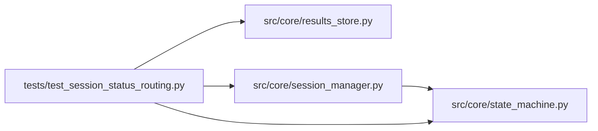

# test_session_status_routing Module

**Path:** `tests/test_session_status_routing.py`

## Description

Routing tests for ARC-011 P0-003 / P0-004.

Verifies that ``SessionManager`` and the orchestrator exit path now drive
session-status changes *through* ``SessionStateMachine.transition`` (the sole
legal writer) and that the W8 contract holds at the routing layer:

  * pause / resume return ``False`` (not raise) against a winding-down or
    terminal session — the pause sibling-of-W8 (ARC-011 §5).
  * ``stop_session`` records the transitional ``stopping`` intent under the
    per-session lock; the orchestrator owns the ``stopping → stopped``
    finalize.
  * a racing ``complete`` against an in-flight stop is refused and the session
    resolves to ``stopped`` with no auto-promote (W8-A).
  * a late stop against terminal ``completed`` is a no-op — it can neither
    overwrite the status nor revoke a promotion (W8-B).

The exhaustive transition table + concurrency stress is P0-005's job
(``tests/test_state_machine.py``); these tests pin the *routing*.

## Imports

| Source | Symbols |
|--------|---------|
| `__future__` | `annotations` |
| `anthropic` | `anthropic` |
| `asyncio` | `asyncio` |
| `datetime` | `datetime`, `timezone` |
| `os` | `os` |
| `pathlib` | `Path` |
| `pytest` | `pytest` |
| `src.core.results_store` | `ResultsStore` |
| `src.core.session_manager` | `ActiveSession`, `SessionManager` |
| `src.core.state_machine` | `IllegalTransitionError`, `SessionEvent` |
| `sys` | `sys` |
| `types` | `types` |
| `unittest.mock` | `MagicMock` |

## Local dependency map

<!-- Auto-generated local dependency summary. Do not edit by hand. -->

### Internal neighbors

| Direction | Module |
|---|---|
| Outbound | [results_store](../modules/results_store.md) |
| Outbound | [session_manager](../modules/session_manager.md) |
| Outbound | [state_machine](../modules/state_machine.md) |

### External packages

| Language | Used packages | Undeclared packages |
|---|---:|---:|
| python | 2 | 2 |

## Classes

| Class | Line | Bases | Description |
|-------|------|-------|-------------|
| [_FakeAsyncAnthropic](../entities/test_session_status_routing_FakeAsyncAnthropic.md) | 39 | — | — |

## Functions

| Function | Signature | Decorators | Description |
|----------|-----------|------------|-------------|
| `_init_store` | *(async)* `(tmp_path: Path) -> ResultsStore` | — | — |
| `_seed_running` | *(async)* `(store: ResultsStore, session_id: str) -> str` | — | — |
| `_done_task` | *(async)* `() -> None` | — | — |
| `_inject_active` | *(async)* `(manager: SessionManager, research_id: str) -> None` | — | Insert a completed task into ``_active`` so the guard checks pass. |
| `test_pause_resume_route_through_state_machine` | *(async)* `(tmp_path: Path) -> None` | `@pytest.mark.asyncio` | — |
| `test_pause_returns_false_when_session_is_winding_down` | *(async)* `(tmp_path: Path) -> None` | `@pytest.mark.asyncio` | — |
| `test_resume_returns_false_when_not_paused` | *(async)* `(tmp_path: Path) -> None` | `@pytest.mark.asyncio` | — |
| `test_stop_session_records_stopping_intent` | *(async)* `(tmp_path: Path) -> None` | `@pytest.mark.asyncio` | — |
| `test_stop_session_refused_when_higher_severity_in_flight` | *(async)* `(tmp_path: Path) -> None` | `@pytest.mark.asyncio` | — |
| `test_w8_racing_complete_against_stop_is_refused_no_promote` | *(async)* `(tmp_path: Path) -> None` | `@pytest.mark.asyncio` | Interleaving A: stop already recorded intent → complete refused. |
| `test_w8_completed_is_terminal_late_stop_is_noop` | *(async)* `(tmp_path: Path) -> None` | `@pytest.mark.asyncio` | Interleaving B: a late stop cannot overwrite completed or revoke promote. |
| `test_w8_hard_timeout_reclassifies_stopped_to_timed_out` | *(async)* `(tmp_path: Path) -> None` | `@pytest.mark.asyncio` | Interleaving C: the documented stopped → timed_out carve-out. |
