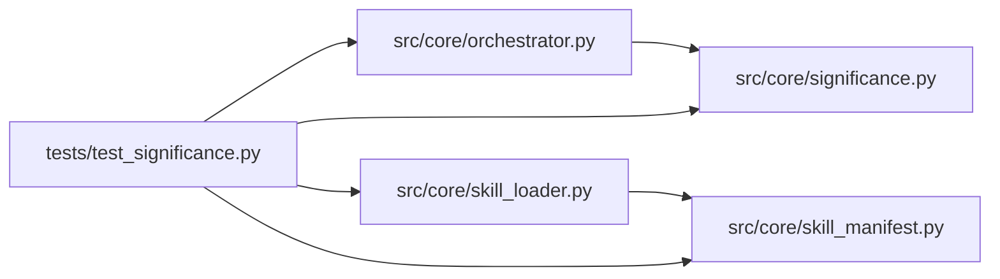

# test_significance Module

**Path:** `tests/test_significance.py`

## Description

P2 multi-seed significance tests.

Covers the pure statistics (``src/core/significance.py``), the manifest
declaration (``metric_schema.significance``), and the orchestrator's
declarative opt-in hook (``_significance_improved`` / ``_infer_decision``)
with a stubbed store — the default path (no declaration) stays
byte-identical to the legacy epsilon test.

## Imports

| Source | Symbols |
|--------|---------|
| `__future__` | `annotations` |
| `json` | `json` |
| `os` | `os` |
| `pytest` | `pytest` |
| `src.core.orchestrator` | `AgentOrchestrator`, `AgentOrchestrator`, `AgentOrchestrator`, `AgentOrchestrator` |
| `src.core.significance` | `INCONCLUSIVE`, `REGRESSION`, `SIGNIFICANT`, `best_config_hash`, `mean_std`, `samples_from_rows`, `significance_verdict` |
| `src.core.skill_loader` | `load_skill_manifest` |
| `src.core.skill_manifest` | `ManifestValidationError` |
| `types` | `SimpleNamespace` |
| `typing` | `Any`, `Optional` |
| `yaml` | `yaml` |

## Local dependency map

<!-- Auto-generated local dependency summary. Do not edit by hand. -->

### Internal neighbors

| Direction | Module |
|---|---|
| Outbound | [orchestrator](../modules/orchestrator.md) |
| Outbound | [significance](../modules/significance.md) |
| Outbound | [skill_loader](../modules/skill_loader.md) |
| Outbound | [skill_manifest](../modules/skill_manifest.md) |

### External packages

| Language | Used packages | Undeclared packages |
|---|---:|---:|
| python | 2 | 1 |

## Classes

| Class | Line | Bases | Description |
|-------|------|-------|-------------|
| [TestMeanStd](../entities/TestMeanStd.md) | 40 | — | — |
| [TestVerdict](../entities/TestVerdict.md) | 54 | — | — |
| [TestRowHelpers](../entities/TestRowHelpers.md) | 116 | — | — |
| [TestManifestDeclaration](../entities/TestManifestDeclaration.md) | 171 | — | — |
| [_StubStore](../entities/test_significance_StubStore.md) | 199 | — | — |

## Functions

| Function | Signature | Decorators | Description |
|----------|-----------|------------|-------------|
| `_row` | `(iteration: int, metric: float, config_hash: str, decision: str = 'keep') -> dict[str, Any]` | — | — |
| `_manifest_dict` | `() -> dict[str, Any]` | — | — |
| `_fake_skill` | `(declared: bool) -> SimpleNamespace` | — | — |
| `test_infer_decision_significant_beats_epsilon` | *(async)* `()` | `@pytest.mark.asyncio` | A noisy candidate whose mean separates by ≥min_sigma is 'improve' |
| `test_infer_decision_regression_blocks_noise_chase` | *(async)* `()` | `@pytest.mark.asyncio` | A single lucky sample above best but whose config's samples regress |
| `test_infer_decision_undeclared_is_byte_identical_legacy` | *(async)* `()` | `@pytest.mark.asyncio` | — |
| `test_significance_sparse_data_falls_back_to_legacy` | *(async)* `()` | `@pytest.mark.asyncio` | — |
