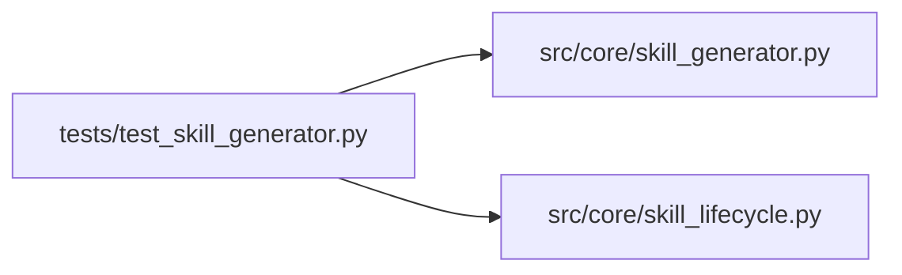

# test_skill_generator Module

**Path:** `tests/test_skill_generator.py`

## Description

Skill generator tests (ARC-011 P5-021..026).

Covers the dedicated-codegen generator (per the Phase-5 plan decision):

* **P5-022** — the generation prompt shape (system + user + JSON schema).
* **P5-023** — drafts land in ``skills/_drafts/<id>/`` with the full file set.
* **P5-026 AC #1** — a generated draft cannot be selected for production until
  promoted (lifecycle gating — tested via the lifecycle machine).
* **P5-026 AC #2** — the command-policy audit flags over-permissive drafts.
* **P5-026 AC #4** — schema-invalid / unparseable LLM output → no draft + raise.

A stub ``LLMProvider`` makes the tests deterministic (no real LLM call).

## Imports

| Source | Symbols |
|--------|---------|
| `__future__` | `annotations` |
| `json` | `json` |
| `pathlib` | `Path` |
| `pytest` | `pytest` |
| `src.core.skill_generator` | `CommandPolicyFinding`, `GeneratedDraft`, `SkillGenerationError`, `SkillGenerator`, `audit_command_policy`, `build_generation_prompt` |
| `src.core.skill_lifecycle` | `SkillLifecycleEvent`, `SkillLifecycleMachine`, `SkillLifecycleState`, `selectable_for` |
| `typing` | `Any` |
| `yaml` | `yaml`, `yaml`, `yaml`, `yaml`, `yaml` |

## Local dependency map

<!-- Auto-generated local dependency summary. Do not edit by hand. -->

### Internal neighbors

| Direction | Module |
|---|---|
| Outbound | [skill_generator](../modules/skill_generator.md) |
| Outbound | [skill_lifecycle](../modules/skill_lifecycle.md) |

### External packages

| Language | Used packages | Undeclared packages |
|---|---:|---:|
| python | 2 | 1 |

## Classes

| Class | Line | Bases | Description |
|-------|------|-------|-------------|
| [StubProvider](../entities/StubProvider.md) | 43 | — | Deterministic stand-in for ``LLMProvider.complete``. |
| [TestGenerationPrompt](../entities/TestGenerationPrompt.md) | 105 | — | — |
| [TestGenerateDraft](../entities/TestGenerateDraft.md) | 124 | — | — |
| [TestGenerateFailurePaths](../entities/TestGenerateFailurePaths.md) | 166 | — | — |
| [TestCommandPolicyAudit](../entities/TestCommandPolicyAudit.md) | 217 | — | — |
| [TestDraftNotSelectableForProduction](../entities/TestDraftNotSelectableForProduction.md) | 275 | — | The lifecycle machine (P5-010) enforces this independently of the |

## Functions

| Function | Signature | Decorators | Description |
|----------|-----------|------------|-------------|
| `_valid_draft_payload` | `(*, skill_id: str = 'gen-skill') -> dict[str, Any]` | — | A JSON payload the generator accepts (valid manifest + bootstrap). |
