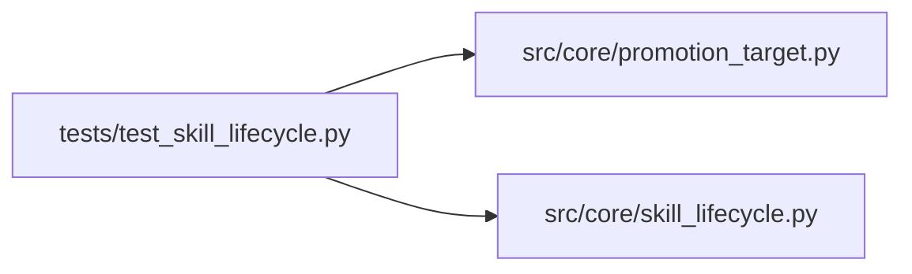

# test_skill_lifecycle Module

**Path:** `tests/test_skill_lifecycle.py`

## Description

Skill lifecycle + promotion tests (ARC-011 P5-010..013).

Covers:

* **P5-010** — the four lifecycle states, the transition table (legal + illegal),
  production gating (drafts excluded), and the per-skill async lock serializing
  concurrent transitions.
* **P5-011** — ``SkillRegistryPromotionTarget`` moves a draft into the live
  skills dir atomically, rejects missing-draft / existing-stable, and rolls
  back on failure.
* **P5-012** wiring is covered indirectly via the target's contract; the HTTP
  endpoints land in a follow-up that wires the FastAPI router (the
  ``src/api/skills.py`` DI pattern is the template).

House style (P1-007): pydantic v2 models, async transitions, fail-closed
precondition checks, no DB handle in the state machine.

## Imports

| Source | Symbols |
|--------|---------|
| `__future__` | `annotations` |
| `asyncio` | `asyncio` |
| `pathlib` | `Path` |
| `pytest` | `pytest` |
| `src.core.promotion_target` | `SkillPromotionError`, `SkillRegistryPromotionTarget` |
| `src.core.skill_lifecycle` | `IllegalLifecycleTransitionError`, `LifecycleTransitionResult`, `SkillLifecycleEvent`, `SkillLifecycleMachine`, `SkillLifecycleState`, `is_legal_transition`, `selectable_for`, `target_state` |

## Local dependency map

<!-- Auto-generated local dependency summary. Do not edit by hand. -->

### Internal neighbors

| Direction | Module |
|---|---|
| Outbound | [promotion_target](../modules/promotion_target.md) |
| Outbound | [skill_lifecycle](../modules/skill_lifecycle.md) |

### External packages

| Language | Used packages | Undeclared packages |
|---|---:|---:|
| python | 1 | 1 |

## Classes

| Class | Line | Bases | Description |
|-------|------|-------|-------------|
| [TestLifecycleStates](../entities/TestLifecycleStates.md) | 46 | — | — |
| [TestTransitionTable](../entities/TestTransitionTable.md) | 59 | — | — |
| [TestProductionGating](../entities/TestProductionGating.md) | 99 | — | P5-010 AC: production sessions require stable; drafts never auto-select. |
| [TestLifecycleMachine](../entities/TestLifecycleMachine.md) | 123 | — | — |
| [TestSkillRegistryPromotionTarget](../entities/TestSkillRegistryPromotionTarget.md) | 195 | — | — |

## Functions

| Function | Signature | Decorators | Description |
|----------|-----------|------------|-------------|
| `_make_draft` | `(skills_root: Path, skill_id: str) -> Path` | — | Create a minimal draft package under ``skills_root/_drafts/<id>/``. |
