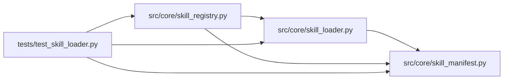

# test_skill_loader Module

**Path:** `tests/test_skill_loader.py`

## Description

Manifest schema + loader + registry tests (ARC-011 P2-001 / P2-002 / P2-003).

These are structural / contract tests in the Phase-1 house style (mirror
``test_output_parser.py`` P1-014, ``test_preflight.py`` P1-022). They pin:

* **P2-001** — the ``ResearchSkillManifest`` schema validates all five X-003
  spike drafts (the GO-verdict stress test), rejects malformed manifests with
  field-specific errors, and covers every section + gap (G1–G13).
* **P2-002** — the loader interpolates ``{settings.*}`` (G6 semantics), reports
  field-specific errors on missing settings, gates ``schema_version``, and
  accepts path / inline-YAML / dict sources.
* **P2-003** — the registry discovers ``skills/<id>/SKILL.yaml``, loads lazily,
  hot-reloads on mtime change, and raises on unknown ids.

The behavioral gate for the downstream ``ManifestSkillRuntime`` is the parity
suite (X-002) + the per-skill suites (P2-008/012/016).

## Imports

| Source | Symbols |
|--------|---------|
| `__future__` | `annotations` |
| `os` | `os` |
| `pathlib` | `Path` |
| `pydantic` | `ValidationError` |
| `pytest` | `pytest` |
| `src.core.skill_loader` | `load_layout`, `load_skill_manifest` |
| `src.core.skill_manifest` | `SCHEMA_VERSION`, `ManifestValidationError`, `ManifestVersionError`, `PluginCaps`, `ResearchSkillManifest` |
| `src.core.skill_registry` | `DEFAULT_SKILLS_ROOT`, `DRAFTS_SUBDIR`, `SKILL_MANIFEST_FILENAME`, `SkillNotRegisteredError`, `SkillRegistry` |
| `time` | `time` |
| `typing` | `Any` |
| `yaml` | `yaml` |

## Local dependency map

<!-- Auto-generated local dependency summary. Do not edit by hand. -->

### Internal neighbors

| Direction | Module |
|---|---|
| Outbound | [skill_loader](../modules/skill_loader.md) |
| Outbound | [skill_manifest](../modules/skill_manifest.md) |
| Outbound | [skill_registry](../modules/skill_registry.md) |

### External packages

| Language | Used packages | Undeclared packages |
|---|---:|---:|
| python | 3 | 1 |

## Classes

| Class | Line | Bases | Description |
|-------|------|-------|-------------|
| [_StubSettings](../entities/test_skill_loader_StubSettings.md) | 55 | — | Minimal settings object exposing every attr the reference manifests |

## Functions

| Function | Signature | Decorators | Description |
|----------|-----------|------------|-------------|
| `_minimal_manifest_dict` | `() -> dict[str, Any]` | — | A minimal valid manifest dict, extended per-test as needed. |
| `test_schema_validates_every_spike_draft` | `(draft_name: str)` | `@pytest.mark.parametrize('draft_name', ['prompt-engineering', 'code-refactor', 'db-config-tuning', 'literature-review'])` | The X-003 GO-verdict stress test: all spike drafts validate against |
| `test_schema_version_is_v1` | `()` | — | — |
| `test_schema_rejects_wrong_schema_version` | `()` | — | — |
| `test_schema_rejects_unknown_top_level_key` | `()` | — | — |
| `test_schema_rejects_unknown_promotion_kind` | `()` | — | — |
| `test_schema_rejects_phase_min_gt_max` | `()` | — | — |
| `test_schema_rejects_duplicate_phase_ids` | `()` | — | — |
| `test_schema_phase_advancement_plugin_requires_plugin_path` | `()` | — | — |
| `test_schema_accepts_all_five_categories` | `(cat: str)` | `@pytest.mark.parametrize('cat', ['optimization', 'generative', 'exploratory', 'validation', 'design'])` | P5-014: the Category literal covers all five ARC-011 §13 values. |
| `test_schema_rejects_unknown_category` | `()` | — | — |
| `test_schema_accepts_feedback_loop_fields` | `()` | — | P5-028/029: auto_absorb_insights + knowledge_last_reviewed + |
| `test_schema_feedback_fields_default_off` | `()` | — | — |
| `test_schema_rejects_zero_refresh_cadence` | `()` | — | — |
| `test_schema_declarative_trial_identity_requires_hash_fields` | `()` | — | — |
| `test_schema_registry_api_requires_production_scope` | `()` | — | — |
| `test_schema_metric_goal_accepts_satisfice` | `()` | — | — |
| `_reference_manifest_dict` | `() -> dict[str, Any]` | — | A domain-neutral manifest exercising ``{settings.*}`` interpolation. |
| `reference_manifest_path` | `(tmp_path: Path) -> Path` | `@pytest.fixture()` | — |
| `test_loader_resolves_settings_placeholders` | `(reference_manifest_path: Path)` | — | Loading the reference manifest resolves ``{settings.*}`` placeholders |
| `test_loader_missing_setting_raises_field_specific_error` | `(reference_manifest_path: Path)` | — | — |
| `test_loader_missing_setting_value_none_raises` | `(reference_manifest_path: Path)` | — | A setting that resolves to ``None`` (present but unset) is an error. |
| `test_loader_rejects_wrong_version_with_version_error` | `()` | — | — |
| `test_loader_accepts_inline_yaml_string` | `()` | — | — |
| `test_loader_accepts_dict_source` | `()` | — | — |
| `test_loader_wraps_validation_errors_field_specific` | `()` | — | — |
| `test_loader_skill_params_unresolvable_at_load_time` | `()` | — | ``{skill_params.*}`` cannot be resolved without session context — a |
| `test_loader_skill_params_resolvable_when_supplied` | `()` | — | — |
| `temp_skills_root` | `(tmp_path: Path) -> Path` | `@pytest.fixture()` | A temp ``skills/`` dir with one valid ``reference-skill`` package. |
| `test_registry_discovers_skill_packages` | `(temp_skills_root: Path)` | — | — |
| `test_registry_loads_lazily_and_caches` | `(temp_skills_root: Path)` | — | — |
| `test_registry_hot_reloads_on_mtime_change` | `(temp_skills_root: Path)` | — | — |
| `test_registry_unknown_id_raises` | `(temp_skills_root: Path)` | — | — |
| `test_registry_register_path` | `(temp_skills_root: Path)` | — | — |
| `test_registry_default_root_points_at_service_skills_dir` | `()` | — | The default discovery root is the service's ``skills/`` dir, NOT |
| `test_schema_accepts_minimal_manifest_without_plugins` | `()` | — | Back-compat: existing skills (no ``plugins`` block) still validate. |
| `test_schema_accepts_declared_plugins_block` | `()` | — | — |
| `test_schema_rejects_duplicate_plugin_kind` | `()` | — | — |
| `test_schema_rejects_duplicate_plugin_path` | `()` | — | — |
| `test_plugin_caps_defaults_are_default_deny` | `()` | — | X-004 §6: a bare ``PluginCaps()`` is default-deny (read-only, no net). |
| `test_load_layout_reports_minimal_package` | `(tmp_path: Path)` | — | A skill with only SKILL.yaml/SKILL.md resolves to an empty layout. |
| `test_load_layout_detects_full_directory_tree` | `(tmp_path: Path)` | — | All optional layout slots are detected from on-disk presence. |
| `test_load_layout_backfills_bootstrap_from_disk_presence` | `(tmp_path: Path)` | — | A skill shipping ``bootstrap.py`` without a manifest ``plugins`` block |
| `test_load_layout_resolves_declared_plugin_caps_to_default` | `(tmp_path: Path)` | — | A declared plugin with ``caps: None`` takes the per-kind default. |
| `test_load_layout_rejects_caps_widening_beyond_kind_default` | `(tmp_path: Path)` | — | R10: a manifest may narrow but not widen plugin caps. A parser declaring |
| `test_load_layout_allows_caps_narrowing` | `(tmp_path: Path)` | — | A manifest may legitimately tighten resource caps (smaller = safer). |
| `test_load_layout_reports_missing_declared_plugin_paths` | `(tmp_path: Path)` | — | A plugin declared in the manifest but absent on disk is flagged. |
| `test_registry_discover_skips_drafts_subdir` | `(tmp_path: Path)` | — | ``_drafts/`` is not enumerated as a top-level skill package. |
| `test_registry_discover_drafts_enumerates_drafts_dir` | `(tmp_path: Path)` | — | ``discover_drafts()`` returns ids under ``_drafts/``. |
| `test_registry_discover_drafts_empty_when_no_dir` | `(tmp_path: Path)` | — | — |
