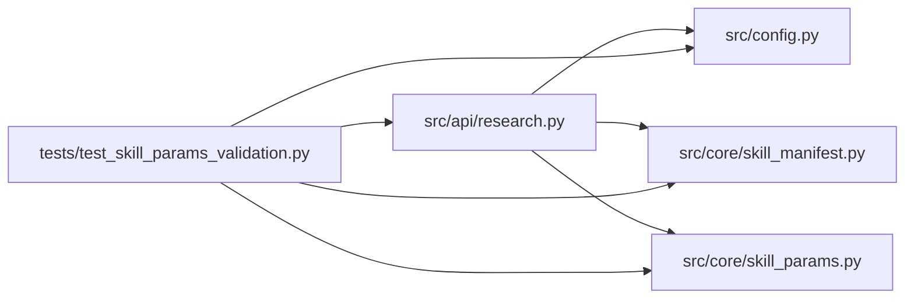

# test_skill_params_validation Module

**Path:** `tests/test_skill_params_validation.py`

## Description

Skill-parameter validation over the declared JSON Schema subset.

Review regressions: invalid bounds and missing required fields are rejected
before session side effects; omitted/null parameter objects are validated by
the one canonical resolution path; bool/number are distinct; enums and nested
structures are enforced with field-addressed errors; permitted extra
properties behave exactly as ``additionalProperties`` declares; defaults are
applied deliberately by resolution, never assumed from validation; and
OpenAPI request/response fixtures stay consistent with the server contract.

## Imports

| Source | Symbols |
|--------|---------|
| `__future__` | `annotations` |
| `fastapi` | `FastAPI` |
| `fastapi.testclient` | `TestClient` |
| `jsonschema` | `Draft202012Validator` |
| `os` | `os` |
| `pathlib` | `Path` |
| `pytest` | `pytest` |
| `src.api` | `research` |
| `src.api.research` | `router` |
| `src.config` | `settings` |
| `src.core.skill_manifest` | `ParamSchema` |
| `src.core.skill_params` | `SCHEMA_DIALECT`, `SUPPORTED_KEYWORDS`, `apply_defaults`, `resolve_and_validate`, `unsupported_schema_keywords`, `validate_resolved` |
| `typing` | `Any`, `Dict` |
| `yaml` | `yaml` |

## Local dependency map

<!-- Auto-generated local dependency summary. Do not edit by hand. -->

### Internal neighbors

| Direction | Module |
|---|---|
| Outbound | [research](../modules/research.md) |
| Outbound | [config](../modules/config.md) |
| Outbound | [skill_manifest](../modules/skill_manifest.md) |
| Outbound | [skill_params](../modules/skill_params.md) |

### External packages

| Language | Used packages | Undeclared packages |
|---|---:|---:|
| python | 4 | 3 |

## Classes

| Class | Line | Bases | Description |
|-------|------|-------|-------------|
| [_StubSessionManager](../entities/StubSessionManager.md) | 44 | — | Records every start attempt so tests can assert side effects never began. |
| [_StubStore](../entities/test_skill_params_validation_StubStore.md) | 82 | — | — |

## Functions

| Function | Signature | Decorators | Description |
|----------|-----------|------------|-------------|
| `_wire` | `(monkeypatch: pytest.MonkeyPatch)` | `@pytest.fixture(autouse=True)` | — |
| `_client` | `() -> TestClient` | — | — |
| `_headers` | `() -> dict[str, str]` | — | — |
| `test_declared_subset_covers_manifest_schemas` | `()` | — | Every bundled skill schema uses only the declared subset keywords. |
| `test_manifest_with_unsupported_keyword_is_rejected_at_load` | `()` | — | A keyword outside the subset can never be silently ignored. |
| `test_omitted_and_null_objects_face_required_fields` | `() -> None` | — | — |
| `test_bool_is_not_a_number` | `() -> None` | — | — |
| `test_numeric_bounds_are_enforced` | `() -> None` | — | — |
| `test_enums_are_enforced` | `() -> None` | — | — |
| `test_nested_structures_are_addressed_field_by_field` | `() -> None` | — | — |
| `test_extra_properties_follow_the_declared_policy` | `() -> None` | — | — |
| `test_defaults_are_applied_by_resolution_not_validation` | `() -> None` | — | — |
| `test_f12_invalid_bounds_rejected_before_session_side_effects` | `() -> None` | — | The bounds reproduction: out-of-bounds DB parameters never start a session. |
| `test_missing_required_field_rejected_even_when_params_omitted` | `() -> None` | — | — |
| `test_valid_request_returns_201_with_defaults_applied` | `() -> None` | — | — |
| `_openapi_components` | `() -> dict` | — | — |
| `test_openapi_fixtures_match_server_authority` | `() -> None` | — | Request fixtures validate against the documented request schema; the |
