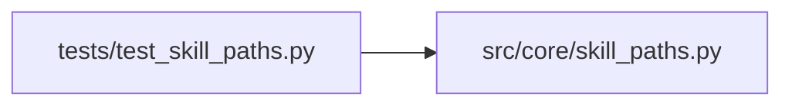

# test_skill_paths Module

**Path:** `tests/test_skill_paths.py`

## Description

ARC-012 P7-005/P7-007 — skill path-template rules (D4).

One closed placeholder vocabulary, load-time validation, sanitized
request-supplied segments. Composed with the G6 loader semantics: dotted
namespaces (``{settings.*}`` / ``{skill_params.*}``) pass through untouched
and absolute templates are accepted (G6 resolves
``{settings.host_configs_path}`` before validation).

## Imports

| Source | Symbols |
|--------|---------|
| `__future__` | `annotations` |
| `pytest` | `pytest` |
| `src.core.skill_paths` | `render_path_template`, `sanitize_path_segment`, `session_workspace_path`, `validate_path_template` |

## Local dependency map

<!-- Auto-generated local dependency summary. Do not edit by hand. -->

### Internal neighbors

| Direction | Module |
|---|---|
| Outbound | [skill_paths](../modules/skill_paths.md) |

### External packages

| Language | Used packages | Undeclared packages |
|---|---:|---:|
| python | 1 | 1 |

## Classes

| Class | Line | Bases | Description |
|-------|------|-------|-------------|
| [TestValidate](../entities/TestValidate.md) | 21 | — | — |
| [TestRender](../entities/TestRender.md) | 56 | — | — |
| [TestSanitizeSegment](../entities/TestSanitizeSegment.md) | 89 | — | — |
| [TestSessionWorkspace](../entities/TestSessionWorkspace.md) | 101 | — | — |
