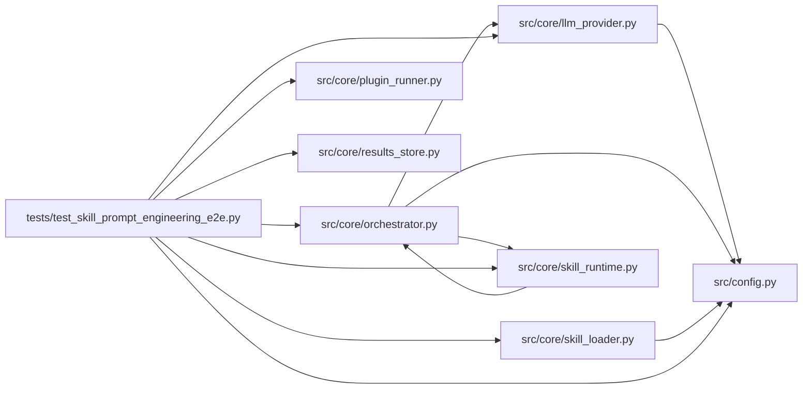

# test_skill_prompt_engineering_e2e Module

**Path:** `tests/test_skill_prompt_engineering_e2e.py`

## Description

P4-016 — End-to-end prompt-engineering session on OpenAI provider (ARC-011).

The Phase-4 milestone: a non-ML domain runs as a first-class peer. Two layers:

* **Asset/contract tests** (manifest shape, provider router, scorer ABI,
  runtime nonce validation, request translation) — deterministic, no spend.
* **The real end-to-end drive** (``test_prompt_engineering_session_end_to_end``,
  added by review C4 2026-08-15): a real ``AgentOrchestrator.run()`` session on
  a real ``OpenAIProvider`` (scripted only at the HTTP client boundary), a real
  governed ``eval/run.py`` subprocess under the skill's manifest command
  policy, the W11 nonce verified in the live loop, a forged marker rejected +
  audited, and the ``research_sessions`` row indistinguishable from an ML row
  except by skill identity.

## Imports

| Source | Symbols |
|--------|---------|
| `__future__` | `annotations` |
| `json` | `json` |
| `openai` | `openai` |
| `os` | `os` |
| `pathlib` | `Path` |
| `pytest` | `pytest` |
| `secrets` | `_secrets` |
| `src.config` | `settings` |
| `src.core` | `orchestrator` |
| `src.core.llm_provider` | `OpenAIProvider`, `build_provider` |
| `src.core.orchestrator` | `AgentOrchestrator`, `ResearchConfig` |
| `src.core.plugin_runner` | `PluginCaps`, `PluginRunner` |
| `src.core.results_store` | `ResultsStore` |
| `src.core.skill_loader` | `load_skill_manifest` |
| `src.core.skill_runtime` | `ManifestSkillRuntime` |
| `subprocess` | `subprocess` |
| `sys` | `sys` |
| `types` | `types` |
| `unittest.mock` | `MagicMock`, `AsyncMock`, `patch` |

## Local dependency map

<!-- Auto-generated local dependency summary. Do not edit by hand. -->

### Internal neighbors

| Direction | Module |
|---|---|
| Outbound | [config](../modules/config.md) |
| Outbound | [llm_provider](../modules/llm_provider.md) |
| Outbound | [orchestrator](../modules/orchestrator.md) |
| Outbound | [plugin_runner](../modules/plugin_runner.md) |
| Outbound | [results_store](../modules/results_store.md) |
| Outbound | [skill_loader](../modules/skill_loader.md) |
| Outbound | [skill_runtime](../modules/skill_runtime.md) |

### External packages

| Language | Used packages | Undeclared packages |
|---|---:|---:|
| python | 2 | 1 |

## Classes

| Class | Line | Bases | Description |
|-------|------|-------|-------------|
| [TestPromptEngineeringSkillManifest](../entities/TestPromptEngineeringSkillManifest.md) | 49 | — | P4-012: the skill manifest loads and declares the Phase-4 properties. |
| [TestCrossProviderRouter](../entities/TestCrossProviderRouter.md) | 125 | — | P4-010: the provider router constructs an OpenAIProvider for openai. |
| [TestEvalScorerNonceEcho](../entities/TestEvalScorerNonceEcho.md) | 139 | — | P4-014: the eval scorer echoes the session nonce in the marker. |
| [TestManifestSkillRuntimeNonceValidation](../entities/TestManifestSkillRuntimeNonceValidation.md) | 163 | — | P4-003: ManifestSkillRuntime threads nonce config from the manifest. |
| [TestCanonicalRequestTranslation](../entities/TestCanonicalRequestTranslation.md) | 226 | — | P4-016 (was mislabeled P4-017 — no such task): non-ML skills are |
| [_ScriptedOpenAIClient](../entities/ScriptedOpenAIClient.md) | 288 | — | Stands in at the OpenAI HTTP boundary (chat.completions.create). |

## Functions

| Function | Signature | Decorators | Description |
|----------|-----------|------------|-------------|
| `test_prompt_engineering_session_end_to_end` | *(async)* `(monkeypatch, tmp_path)` | `@pytest.mark.asyncio` | — |
