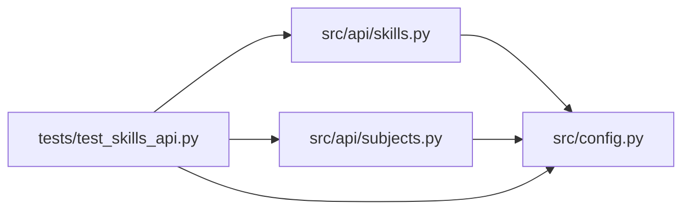

# test_skills_api Module

**Path:** `tests/test_skills_api.py`

## Description

Skill & subject endpoint contract tests (ARC-011 P3-012, GEN-003).

Exercises the full skill API surface introduced in Phase 3:
``GET /skills``, ``GET /skills/{id}``, the schema/form/metric sub-resources,
``POST /skills/reload``, and the subject/variant enumeration endpoints.
Also asserts the OpenAPI contract documents them under ``/api/v1`` (not the
legacy ``/api`` prefix) and that auth is enforced.

## Imports

| Source | Symbols |
|--------|---------|
| `__future__` | `annotations` |
| `fastapi` | `FastAPI` |
| `fastapi.testclient` | `TestClient` |
| `os` | `os` |
| `pytest` | `pytest` |
| `src.api` | `skills`, `subjects` |
| `src.api.skills` | `router` |
| `src.api.subjects` | `router` |
| `src.config` | `settings` |

## Local dependency map

<!-- Auto-generated local dependency summary. Do not edit by hand. -->

### Internal neighbors

| Direction | Module |
|---|---|
| Outbound | [src_api_skills](../modules/src_api_skills.md) |
| Outbound | [subjects](../modules/subjects.md) |
| Outbound | [config](../modules/config.md) |

### External packages

| Language | Used packages | Undeclared packages |
|---|---:|---:|
| python | 2 | 2 |

## Functions

| Function | Signature | Decorators | Description |
|----------|-----------|------------|-------------|
| `create_test_app` | `() -> FastAPI` | — | — |
| `configure_auth` | `(monkeypatch: pytest.MonkeyPatch)` | `@pytest.fixture(autouse=True)` | — |
| `client` | `() -> TestClient` | `@pytest.fixture` | — |
| `auth_headers` | `() -> dict[str, str]` | — | — |
| `test_list_skills_returns_installed_skills` | `(client: TestClient)` | — | — |
| `test_list_skills_carries_legacy_model_type_alias` | `(client: TestClient)` | — | — |
| `test_list_skills_category_filter` | `(client: TestClient)` | — | — |
| `test_get_skill_returns_descriptor_with_links` | `(client: TestClient)` | — | — |
| `test_get_skill_unknown_returns_404_with_hint` | `(client: TestClient)` | — | — |
| `test_get_param_schema` | `(client: TestClient)` | — | — |
| `test_get_form_fields` | `(client: TestClient)` | — | — |
| `test_get_metric_schema` | `(client: TestClient)` | — | — |
| `test_get_versions` | `(client: TestClient)` | — | — |
| `test_get_changelog` | `(client: TestClient)` | — | — |
| `test_get_changelog_too_large_returns_413` | `(client: TestClient, monkeypatch: pytest.MonkeyPatch, tmp_path)` | — | A skill whose ``CHANGELOG.md`` exceeds the cap returns 413 with a |
| `test_reload_skills` | `(client: TestClient)` | — | — |
| `test_reload_blocked_in_production` | `(client: TestClient, monkeypatch: pytest.MonkeyPatch)` | — | P3-008: hot-reload is a dev convenience and must be disabled in prod. |
| `test_reload_allowed_in_staging` | `(client: TestClient, monkeypatch: pytest.MonkeyPatch)` | — | Non-production environments keep the dev convenience available. |
| `test_list_subjects` | `(client: TestClient)` | — | — |
| `test_list_subject_variants` | `(client: TestClient)` | — | — |
| `test_subjects_unknown_skill_returns_404` | `(client: TestClient)` | — | An unknown ``skill_id`` returns the same structured 404 detail shape as |
| `test_skills_require_auth` | `(client: TestClient)` | — | — |
| `test_openapi_documents_skills_endpoints_under_api_v1` | `()` | — | — |
| `test_openapi_hides_skills_endpoints_under_legacy_api_prefix` | `()` | — | — |
