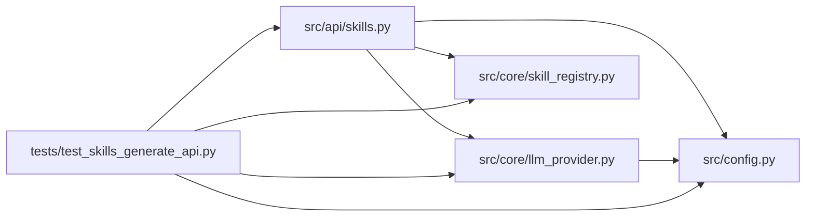

# test_skills_generate_api Module

**Path:** `tests/test_skills_generate_api.py`

## Description

POST /skills/generate endpoint tests (P2 Skill SDK).

Contract: feature-flagged (403 when ``skill_generator_enabled`` is off),
audited, validated drafts into ``skills/_drafts/<id>/`` via the real
``SkillGenerator`` with a stubbed LLM provider. Promotion is deliberately
NOT offered here — moving drafts into the live tree stays an operator act
(``autoresearch promote-skill``).

## Imports

| Source | Symbols |
|--------|---------|
| `__future__` | `annotations` |
| `fastapi` | `FastAPI` |
| `fastapi.testclient` | `TestClient` |
| `json` | `json` |
| `os` | `os` |
| `pathlib` | `Path` |
| `pytest` | `pytest` |
| `src.api.skills` | `router` |
| `src.config` | `settings` |
| `src.core` | `llm_provider`, `skill_registry` |
| `typing` | `Any` |
| `yaml` | `yaml`, `_yaml` |

## Local dependency map

<!-- Auto-generated local dependency summary. Do not edit by hand. -->

### Internal neighbors

| Direction | Module |
|---|---|
| Outbound | [src_api_skills](../modules/src_api_skills.md) |
| Outbound | [config](../modules/config.md) |
| Outbound | [llm_provider](../modules/llm_provider.md) |
| Outbound | [skill_registry](../modules/skill_registry.md) |

### External packages

| Language | Used packages | Undeclared packages |
|---|---:|---:|
| python | 3 | 2 |

## Classes

| Class | Line | Bases | Description |
|-------|------|-------|-------------|
| [_StubProvider](../entities/test_skills_generate_api_StubProvider.md) | 40 | — | — |

## Functions

| Function | Signature | Decorators | Description |
|----------|-----------|------------|-------------|
| `create_test_app` | `() -> FastAPI` | — | — |
| `_payload` | `(*, skill_id: str = 'api-gen-skill') -> dict[str, Any]` | — | — |
| `hermetic_skills_tree` | `(monkeypatch: pytest.MonkeyPatch, tmp_path: Path) -> Path` | `@pytest.fixture(autouse=True)` | Keep drafts out of the packaged skills/ tree and pin the auth token. |
| `client` | `() -> TestClient` | `@pytest.fixture` | — |
| `_auth` | `() -> dict[str, str]` | — | — |
| `test_generate_disabled_by_default` | `(client: TestClient)` | — | — |
| `test_generate_creates_draft_when_enabled` | `(client: TestClient, monkeypatch: pytest.MonkeyPatch, hermetic_skills_tree: Path)` | — | — |
| `test_generate_reports_critical_findings` | `(client: TestClient, monkeypatch: pytest.MonkeyPatch)` | — | — |
| `test_generate_invalid_llm_output_is_422` | `(client: TestClient, monkeypatch: pytest.MonkeyPatch, hermetic_skills_tree: Path)` | — | — |
| `test_generate_requires_auth` | `(client: TestClient)` | — | — |
