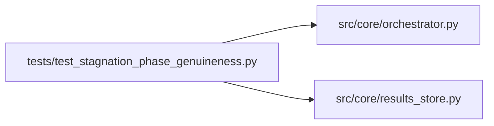

# test_stagnation_phase_genuineness Module

**Path:** `tests/test_stagnation_phase_genuineness.py`

## Description

Tests for phase-genuineness check on the stagnation exemption.

Background: `stagnation_exempt_phases` (e.g. `promotion_proposal`,
`tsfm_sweeps`) suppresses the global stagnation termination. But if a
session reaches one of these phases ONLY via `auto_phase_evidence: True`
emitted by prepare.py (the infrastructure-fallback path), the agent is
still doing tabular HPO work, not real promotion/validation. The
exemption should not apply.

## Imports

| Source | Symbols |
|--------|---------|
| `__future__` | `annotations` |
| `anthropic` | `anthropic` |
| `json` | `json` |
| `os` | `os` |
| `pathlib` | `Path` |
| `pytest` | `pytest` |
| `src.core.orchestrator` | `AgentOrchestrator` |
| `src.core.results_store` | `ResultsStore` |
| `sys` | `sys` |
| `types` | `types`, `ModuleType` |
| `typing` | `cast` |

## Local dependency map

<!-- Auto-generated local dependency summary. Do not edit by hand. -->

### Internal neighbors

| Direction | Module |
|---|---|
| Outbound | [orchestrator](../modules/orchestrator.md) |
| Outbound | [results_store](../modules/results_store.md) |

### External packages

| Language | Used packages | Undeclared packages |
|---|---:|---:|
| python | 2 | 2 |

## Functions

| Function | Signature | Decorators | Description |
|----------|-----------|------------|-------------|
| `_seed_session_with_iterations` | *(async)* `(store: ResultsStore, session_id: str, *, workspace: Path, iterations: list[dict], current_phase: str) -> None` | — | — |
| `test_auto_evidence_only_phase_is_not_genuine` | *(async)* `(tmp_path: Path) -> None` | `@pytest.mark.asyncio` | When the only iterations in promotion_proposal carry |
| `test_explicit_phase_key_makes_phase_genuine` | *(async)* `(tmp_path: Path) -> None` | `@pytest.mark.asyncio` | When at least one iteration in the phase carries an agent-explicit |
| `test_no_iterations_in_phase_is_not_genuine` | *(async)* `(tmp_path: Path) -> None` | `@pytest.mark.asyncio` | When there are no iterations carrying the current phase label, the |
| `test_non_auto_evidence_iteration_is_genuine` | *(async)* `(tmp_path: Path) -> None` | `@pytest.mark.asyncio` | Any iteration in-phase without auto_phase_evidence is enough. |
| `test_gc_fallback_key_outside_tsfm_is_ignored` | *(async)* `(tmp_path: Path) -> None` | `@pytest.mark.asyncio` | The tsfm_fallback_validation recognition is scoped to tsfm_sweeps; the |
