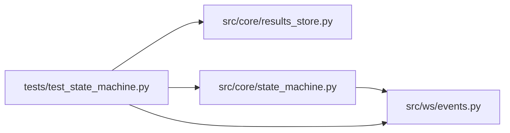

# test_state_machine Module

**Path:** `tests/test_state_machine.py`

## Description

Unit tests for ``SessionStateMachine`` (ARC-011 P0-002).

Exercises the full §4.1 transition table, the §5 guards, the §4.2 severity
overrides (the W8 fix), §7.2 idempotency, the per-session lock serialization,
and the broadcast/status-field parity merges. Uses a real ``ResultsStore`` on a
tmp SQLite file plus a capturing broadcaster; the orchestrator / promoter are
not involved (those are P0-003 / P0-004 / P0-005).

## Imports

| Source | Symbols |
|--------|---------|
| `__future__` | `annotations` |
| `asyncio` | `asyncio` |
| `os` | `os` |
| `pathlib` | `Path` |
| `pytest` | `pytest` |
| `src.core.results_store` | `ResultsStore` |
| `src.core.state_machine` | `IllegalTransitionError`, `SessionEvent`, `SessionLockRegistry`, `SessionState`, `SessionStateMachine`, `TransitionResult` |
| `src.ws.events` | `EventBroadcaster` |
| `sys` | `sys` |
| `typing` | `Any`, `Dict`, `List`, `Tuple` |

## Local dependency map

<!-- Auto-generated local dependency summary. Do not edit by hand. -->

### Internal neighbors

| Direction | Module |
|---|---|
| Outbound | [results_store](../modules/results_store.md) |
| Outbound | [state_machine](../modules/state_machine.md) |
| Outbound | [events](../modules/events.md) |

### External packages

| Language | Used packages | Undeclared packages |
|---|---:|---:|
| python | 1 | 1 |

## Classes

| Class | Line | Bases | Description |
|-------|------|-------|-------------|
| [_CapturingBroadcaster](../entities/CapturingBroadcaster.md) | 39 | `EventBroadcaster` | An ``EventBroadcaster`` that records broadcasts instead of sending them. |

## Functions

| Function | Signature | Decorators | Description |
|----------|-----------|------------|-------------|
| `_make_store` | *(async)* `(tmp_path: Path) -> ResultsStore` | — | — |
| `_seed` | *(async)* `(store: ResultsStore, *, session_id: str = 'sess-1', status: str = 'running') -> str` | — | Insert a session row (always as ``running``) then move it to ``status``. |
| `_audit_count` | *(async)* `(store: ResultsStore, session_id: str) -> int` | — | — |
| `_status_of` | `(session: Dict[str, Any]) -> SessionState` | — | — |
| `test_legal_transition` | *(async)* `(tmp_path: Path, initial: str, event: SessionEvent, expected_state: SessionState, broadcast: Any, promote: bool) -> None` | `@pytest.mark.parametrize('initial, event, expected_state, broadcast, promote', _LEGAL_CASES, ids=[c[1].value for c in _LEGAL_CASES])` | — |
| `test_illegal_transition_raises_and_writes_nothing` | *(async)* `(tmp_path: Path, initial: str, event: SessionEvent) -> None` | `@pytest.mark.parametrize('initial, event', _ILLEGAL_CASES, ids=[f'{i}-{e.value}' for i, e in _ILLEGAL_CASES])` | — |
| `test_noop_transition_writes_nothing` | *(async)* `(tmp_path: Path, initial: str, event: SessionEvent) -> None` | `@pytest.mark.parametrize('initial, event', _NOOP_CASES, ids=[f'{i}-{e.value}' for i, e in _NOOP_CASES])` | — |
| `test_completing_plus_stop_redirects_to_stopping_no_autopromote` | *(async)* `(tmp_path: Path) -> None` | — | The headline W8 fix: a racing stop discards the completion intent. |
| `test_completing_outranked_by_more_severe` | *(async)* `(tmp_path: Path, event: SessionEvent, expected: SessionState) -> None` | `@pytest.mark.parametrize('event, expected', [(SessionEvent.TIMEOUT, SessionState.TIMED_OUT), (SessionEvent.HARD_TIMEOUT, SessionState.TIMED_OUT), (SessionEvent.FAIL, SessionState.FAILED)])` | — |
| `test_severity_redirects_from_other_transitional` | *(async)* `(tmp_path: Path, initial: str, event: SessionEvent, expected: SessionState) -> None` | `@pytest.mark.parametrize('initial, event, expected', [('stopping', SessionEvent.TIMEOUT, SessionState.TIMED_OUT), ('stopping', SessionEvent.HARD_TIMEOUT, SessionState.TIMED_OUT), ('stopping', SessionEvent.FAIL, SessionState.FAILED), ('timing_out', SessionEvent.FAIL, SessionState.FAILED)])` | — |
| `test_stopped_hard_timeout_reclassifies_to_timed_out` | *(async)* `(tmp_path: Path) -> None` | — | The one documented terminal exit (interleaving C). |
| `test_complete_writes_completing_then_completed` | *(async)* `(tmp_path: Path) -> None` | — | — |
| `test_fail_persists_status_fields_on_terminal_write` | *(async)* `(tmp_path: Path) -> None` | — | — |
| `test_complete_broadcast_merges_domain_fields` | *(async)* `(tmp_path: Path) -> None` | — | — |
| `test_recovery_target_interrupted` | *(async)* `(tmp_path: Path) -> None` | — | — |
| `test_invalid_recovery_target_raises` | *(async)* `(tmp_path: Path) -> None` | — | — |
| `test_concurrent_complete_and_stop_never_corrupts` | *(async)* `(tmp_path: Path) -> None` | — | Concurrent complete + stop on one session: exactly one intent wins and |
| `test_missing_session_raises_lookup_error` | *(async)* `(tmp_path: Path) -> None` | — | — |
| `test_lock_evicted_on_terminal` | *(async)* `(tmp_path: Path) -> None` | — | — |
