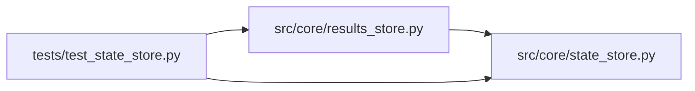

# test_state_store Module

**Path:** `tests/test_state_store.py`

## Description

Structural / contract tests for the ``StateStore`` protocol (ARC-011
P1-006) and the ``SQLiteStateStore`` implementation (P1-007).

Mirrors ``tests/test_llm_provider.py`` (P1-005): these tests pin the public
surface of the protocol and guard against signature drift between the protocol
declaration and the concrete implementation. They are not behavioral tests —
behavior is covered by the existing ``ResultsStore`` suite (which now exercises
``SQLiteStateStore`` via the back-compat alias) and the X-002 parity fixtures.

## Imports

| Source | Symbols |
|--------|---------|
| `__future__` | `annotations` |
| `inspect` | `inspect` |
| `pytest` | `pytest` |
| `src.core.results_store` | `ResultsStore` |
| `src.core.state_store` | `SQLiteStateStore`, `StateStore` |
| `typing` | `Protocol` |

## Local dependency map

<!-- Auto-generated local dependency summary. Do not edit by hand. -->

### Internal neighbors

| Direction | Module |
|---|---|
| Outbound | [results_store](../modules/results_store.md) |
| Outbound | [state_store](../modules/state_store.md) |

### External packages

| Language | Used packages | Undeclared packages |
|---|---:|---:|
| python | 1 | 1 |

## Functions

| Function | Signature | Decorators | Description |
|----------|-----------|------------|-------------|
| `test_state_store_protocol_is_typing_time_contract` | `()` | — | ``StateStore`` is a ``Protocol`` and is **not** ``@runtime_checkable``. |
| `test_state_store_protocol_surface_matches_sqlite_impl` | `()` | — | Every method declared on ``StateStore`` exists on ``SQLiteStateStore``. |
| `test_minimal_state_store_satisfies_protocol` | `()` | — | Executable documentation of the contract. |
| `test_results_store_alias_is_same_class_object` | `()` | — | The back-compat alias binds to the **same** class object, not a subclass. |
