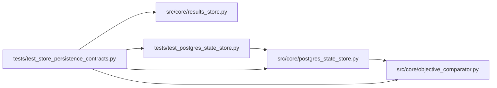

# test_store_persistence_contracts Module

**Path:** `tests/test_store_persistence_contracts.py`

## Description

Persistence contracts shared by both stores: selection and promotion.

The same test bodies run against SQLite (always) and Postgres (when
AUTORESEARCH_DATABASE_URL is set): the winner-selection semantics (objective
direction, ties, missing values, failed gates) and the promotion record
semantics (canonical identity metadata, effect acknowledgement, rollback
records) are persistence-level contracts, so every store implementation must
demonstrate them.

## Imports

| Source | Symbols |
|--------|---------|
| `__future__` | `annotations` |
| `asyncpg` | `asyncpg` |
| `json` | `json` |
| `os` | `os` |
| `pytest` | `pytest` |
| `src.core.objective_comparator` | `ObjectiveComparator` |
| `src.core.postgres_state_store` | `PostgresStateStore` |
| `src.core.results_store` | `ResultsStore` |
| `tests.test_postgres_state_store` | `_base_dsn` |
| `uuid` | `uuid` |

## Local dependency map

<!-- Auto-generated local dependency summary. Do not edit by hand. -->

### Internal neighbors

| Direction | Module |
|---|---|
| Outbound | [objective_comparator](../modules/objective_comparator.md) |
| Outbound | [postgres_state_store](../modules/postgres_state_store.md) |
| Outbound | [results_store](../modules/results_store.md) |
| Outbound | [test_postgres_state_store](../modules/test_postgres_state_store.md) |

### External packages

| Language | Used packages | Undeclared packages |
|---|---:|---:|
| python | 2 | 1 |

## Functions

| Function | Signature | Decorators | Description |
|----------|-----------|------------|-------------|
| `_pg_admin_dsn` | `() -> str \| None` | — | — |
| `store` | *(async)* `(request, tmp_path)` | `@pytest.fixture(params=['sqlite', 'postgres'])` | — |
| `_seed_session` | *(async)* `(store, research_id: str) -> None` | — | — |
| `_add` | *(async)* `(store, research_id: str, iteration: int, metric, *, decision: str, gates: bool = True, objective) -> None` | — | — |
| `_best` | *(async)* `(store, research_id: str)` | — | — |
| `test_minimization_selection_persists` | *(async)* `(store)` | `@pytest.mark.asyncio` | — |
| `test_maximization_selection_persists` | *(async)* `(store)` | `@pytest.mark.asyncio` | — |
| `test_ties_within_epsilon_do_not_move_best` | *(async)* `(store)` | `@pytest.mark.asyncio` | — |
| `test_missing_metric_never_moves_best` | *(async)* `(store)` | `@pytest.mark.asyncio` | — |
| `test_failed_gates_never_raise_the_bar` | *(async)* `(store)` | `@pytest.mark.asyncio` | — |
| `_seed_promotion` | *(async)* `(store, research_id: str, metadata: dict, name: str)` | — | — |
| `test_promotion_identity_metadata_round_trips` | *(async)* `(store)` | `@pytest.mark.asyncio` | — |
| `test_effect_ack_and_rollback_records_round_trip` | *(async)* `(store)` | `@pytest.mark.asyncio` | — |
