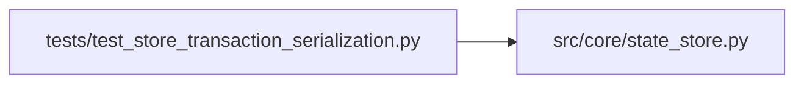

# test_store_transaction_serialization Module

**Path:** `tests/test_store_transaction_serialization.py`

## Description

Transaction-span serialization on the shared SQLite connection.

aiosqlite serializes statements but not transaction spans: concurrent
unlocked implicit writes used to interleave with BEGIN IMMEDIATE
sections and fail with "cannot start a transaction within a
transaction". The task-reentrant connection lock serializes spans and
stays deadlock-free for same-task nesting.

## Imports

| Source | Symbols |
|--------|---------|
| `__future__` | `annotations` |
| `asyncio` | `asyncio` |
| `src.core.state_store` | `CapacityExceeded`, `SQLiteStateStore` |

## Local dependency map

<!-- Auto-generated local dependency summary. Do not edit by hand. -->

### Internal neighbors

| Direction | Module |
|---|---|
| Outbound | [state_store](../modules/state_store.md) |

## Functions

| Function | Signature | Decorators | Description |
|----------|-----------|------------|-------------|
| `_build` | *(async)* `(tmp_path)` | — | — |
| `test_concurrent_implicit_and_explicit_transactions_serialize` | `(tmp_path)` | — | — |
| `test_same_task_nested_connection_use_is_deadlock_free` | `(tmp_path)` | — | — |
| `test_capacity_limits_still_enforced_under_contention` | `(tmp_path)` | — | — |
