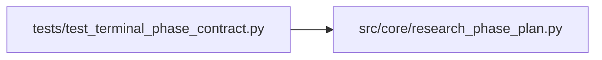

# test_terminal_phase_contract Module

**Path:** `tests/test_terminal_phase_contract.py`

## Description

Fix D/G: terminal-phase contract.

The terminal phase (`promotion_proposal`) used to stay `in_progress` forever
once reached — even with its evidence satisfied — because `_phase_status`
special-cased the current phase. `incomplete_phase_ids` then always listed it
and the end-turn guard nudged the agent into another doomed experiment. These
tests pin the corrected behaviour and the separated in-phase / stall counters.

## Imports

| Source | Symbols |
|--------|---------|
| `__future__` | `annotations` |
| `src.core.research_phase_plan` | `DIRECTION_PHASES`, `_next_action`, `_phase_status`, `build_phase_state`, `incomplete_phase_ids` |

## Local dependency map

<!-- Auto-generated local dependency summary. Do not edit by hand. -->

### Internal neighbors

| Direction | Module |
|---|---|
| Outbound | [research_phase_plan](../modules/research_phase_plan.md) |

## Functions

| Function | Signature | Decorators | Description |
|----------|-----------|------------|-------------|
| `_terminal_id` | `() -> str` | — | — |
| `test_terminal_phase_completed_when_evidence_satisfied` | `() -> None` | — | — |
| `test_terminal_phase_blocked_takes_priority` | `() -> None` | — | — |
| `test_terminal_phase_in_progress_when_not_yet_complete` | `() -> None` | — | — |
| `test_next_action_directs_stop_when_all_complete` | `() -> None` | — | — |
| `test_in_phase_counter_excludes_other_phases` | `() -> None` | — | iterations_in_current_phase counts only rows tagged to the current |
| `test_incomplete_phase_ids_empty_when_terminal_complete` | `() -> None` | — | When the terminal phase reports completed, incomplete_phase_ids is empty |
