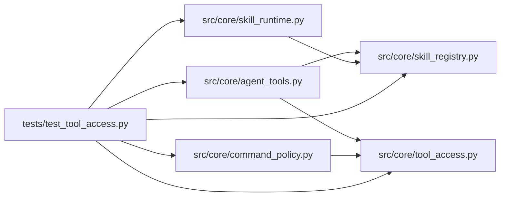

# test_tool_access Module

**Path:** `tests/test_tool_access.py`

## Description

Tool-dispatch authorization regressions for the shared file-tool context.

Every file operation (read, write, glob, grep, copy, and path-bearing tool
arguments) must resolve through one server-derived authorization context:
a run may only reach its own session workspace, never sibling sessions,
control-plane storage, interpreter environments, or evaluator assets, while
allowed candidate edits keep working. Server-owned evidence and skill-
declared evaluation data are not candidate-writable.

## Imports

| Source | Symbols |
|--------|---------|
| `__future__` | `annotations` |
| `hashlib` | `hashlib` |
| `os` | `os` |
| `pathlib` | `Path` |
| `pytest` | `pytest` |
| `src.core.agent_tools` | `_execute_tool`, `_tool_glob`, `_tool_grep` |
| `src.core.command_policy` | `evaluate_command_policy` |
| `src.core.skill_registry` | `default_registry` |
| `src.core.skill_runtime` | `ManifestSkillRuntime` |
| `src.core.tool_access` | `PROTECTED_SESSION_DIRS`, `build_tool_access_context` |
| `unittest.mock` | `MagicMock` |

## Local dependency map

<!-- Auto-generated local dependency summary. Do not edit by hand. -->

### Internal neighbors

| Direction | Module |
|---|---|
| Outbound | [agent_tools](../modules/agent_tools.md) |
| Outbound | [command_policy](../modules/command_policy.md) |
| Outbound | [skill_registry](../modules/skill_registry.md) |
| Outbound | [skill_runtime](../modules/skill_runtime.md) |
| Outbound | [tool_access](../modules/tool_access.md) |

### External packages

| Language | Used packages | Undeclared packages |
|---|---:|---:|
| python | 1 | 1 |

## Functions

| Function | Signature | Decorators | Description |
|----------|-----------|------------|-------------|
| `_setup` | `(tmp_path: Path) -> tuple[str, str, str]` | — | — |
| `_access` | `(shared: str, session_a: str)` | — | — |
| `test_context_roots_come_from_run_ownership` | `(tmp_path: Path) -> None` | — | — |
| `test_context_protects_server_owned_state` | `(tmp_path: Path) -> None` | — | — |
| `test_read_file_cannot_inspect_sibling_session` | `(tmp_path: Path) -> None` | — | — |
| `test_read_file_sibling_style_path_never_returns_content` | `(tmp_path: Path) -> None` | — | — |
| `test_read_file_rejects_paths_outside_any_root` | `(tmp_path: Path) -> None` | — | — |
| `test_control_plane_files_never_reachable` | `(tmp_path: Path, target: str) -> None` | `@pytest.mark.parametrize('target', ['db/experiments.db', '.env'])` | — |
| `test_interpreter_environment_and_evaluator_code_unreachable` | `(tmp_path: Path) -> None` | — | — |
| `test_write_file_cannot_modify_sibling_candidate` | `(tmp_path: Path) -> None` | — | — |
| `test_write_file_rejects_traversal_and_shared_root_targets` | `(tmp_path: Path) -> None` | — | — |
| `test_allowed_candidate_edits_still_work` | `(tmp_path: Path) -> None` | — | — |
| `test_server_owned_state_is_not_candidate_writable` | `(tmp_path: Path, target: str) -> None` | `@pytest.mark.parametrize('target', ['server_snapshots/iteration_0001_results.json', 'command_logs/turn.log', '.trials/turn-001-seq-01/config.json', 'research_manifest.json', 'research_manifest_res9.json', 'session_bootstrap.v1.json'])` | — |
| `test_skill_declared_evaluation_data_is_write_protected` | `(tmp_path: Path) -> None` | — | — |
| `test_glob_expansion_cannot_escape_the_roots` | `(tmp_path: Path) -> None` | — | — |
| `test_grep_rejects_outside_search_paths_and_finds_own_files` | `(tmp_path: Path) -> None` | — | — |
| `_skill_extension` | `() -> dict` | — | — |
| `test_cp_destination_faces_write_protection` | `(tmp_path: Path) -> None` | — | — |
| `test_cp_and_cat_reject_sibling_and_outside_paths` | `(tmp_path: Path) -> None` | — | — |
| `test_config_flag_path_faces_shared_authorization` | `(tmp_path: Path) -> None` | — | — |
| `test_legacy_style_workspace_paths_still_authorize` | `(tmp_path: Path) -> None` | — | — |
| `test_write_file_rejects_symlink_leaves` | `(tmp_path: Path) -> None` | — | — |
| `test_write_file_rejects_hardlinked_alias` | `(tmp_path: Path) -> None` | — | — |
| `test_cp_source_must_not_be_a_link_or_alias` | `(tmp_path: Path) -> None` | — | — |
| `test_skill_manifest_evaluation_data_declaration_is_enforced` | `() -> None` | — | — |
